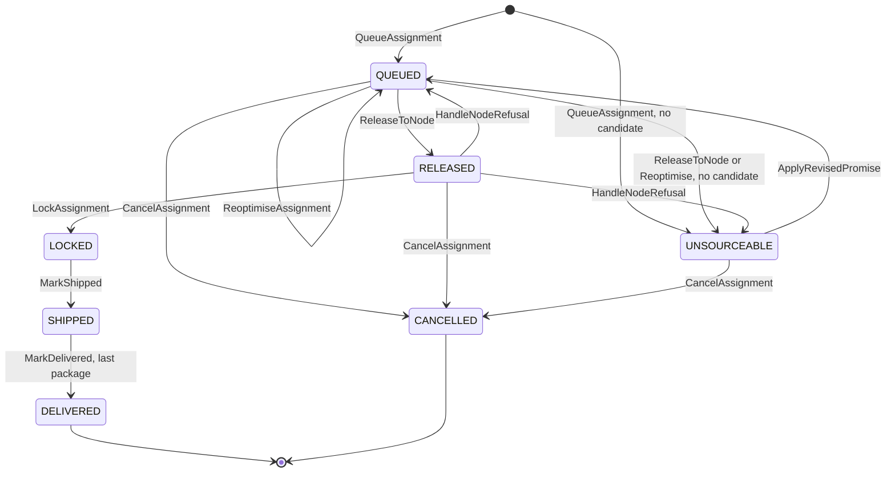

# Aggregate design canvas

Following the ddd-crew [Aggregate Design Canvas v1.1](https://github.com/ddd-crew/aggregate-design-canvas). The context has one
aggregate root, **FulfillmentAssignment**. Everything else it holds is a read model fed by sibling events. Source:
`internal/domain/assignment` (`assignment.go`, `commands.go`, `errors.go`, `events.go`, `types.go`) and
[ADR 0002](/docs/adr/0002-aggregates-invariants-and-assumptions).

## FulfillmentAssignment

### 1. Name

`FulfillmentAssignment`, the Go type `assignment.Assignment` in `internal/domain/assignment`, identified by `assignmentId`
(`asg-<uuid>`, minted by `internal/adapters/outbound/ids`).

### 2. Description

One shipment group of one customer order, its promise constraint, the current candidate node and path, and the history of
releases. It carries:

| Part | Shape |
| --- | --- |
| Identity and correlation | `assignmentId`; `orderId`, `groupNo` (unique together) |
| Destination | `destinationPostalPrefix` from `CustomerOrderPlaced`, matched exactly to a service area to find the delivery station |
| Promise constraint | `PromiseConstraint{promiseId, tier, deliverByLatest, witnessNodeId, revisionNo}` |
| Lines | `Line{lineNo, catalogItemId, listingId, quantity}`, at most 200; `listingId` is set from the first release |
| Current candidate | `Candidate{nodeId, pickupDepartureId, pickupCutoffAt, legs[], deliveryWaveId, eta, cost}` |
| Release point | `releaseAt` (virtual queue) |
| Release history | `Release{no, nodeId, releasedAt, requiredShipBy, outcome, reasonCode}` |
| Exclusions | `ExcludedNode{nodeId, reason}`, reset by a higher promise `revisionNo` |
| Concurrency | `version`, strictly increasing |
| Lock and outcome facts | `lockedAt`, `lockReason`, `pickupDepartureId`, `trackingNumbers`, `shippedAt`, delivered packages, `deliveredAt`, `cancelReason` |

It owns no stock and no capacity. It does not compute the promise, and it does not run the purchase-order clock (`ackBy` belongs
to `vendor-connectivity`).

### 3. State transitions

Source: `internal/domain/assignment/commands.go`, `assignment.go` (`Queue`). `DELIVERED` and `CANCELLED` are terminal
(`State.Terminal`). `ApplyRevisedPromise` also changes the constraint in `RELEASED`, `LOCKED` and `SHIPPED` and a `QUEUED`
assignment with no candidate under the new constraint becomes `UNSOURCEABLE`. `RefuseCancel` and `MovePickup` keep the state.
In `RELEASED` exactly one release is `PENDING`; from `LOCKED` on, the node never changes.

### 4. Enforced invariants

| Invariant | Enforced by |
| --- | --- |
| A released candidate's `eta` is not after `deliverByLatest` | `checkCandidate` in every method that sets a candidate: `ErrCandidateBreaksPromise` |
| No change of node after `LOCKED` | `Reoptimise` (`guardMovable`) and `RefuseRelease` on a committed state: `ErrAssignmentLocked` |
| A node that refused this group is not chosen again for the same promise revision | `checkCandidate`: `ErrNodeExcluded` |
| At most one release `PENDING` | `Reoptimise` and `Release` while `RELEASED`: `ErrReleaseInFlight` |
| `version` strictly increases | the repository compare-and-swap (`ErrConcurrentUpdate`) and the optional caller version of `Reoptimise` (`ErrStaleAssignmentVersion`) |
| Cancel only before `LOCKED`; a later request is refused | `Cancel`: `ErrCancelAfterLock`, then `RefuseCancel` |
| A late outcome of an old release is not applied | `pendingRelease`: `ErrReleaseNotPending` |
| A promise revision must be above the applied one | `ApplyRevisedPromise`: `ErrStaleRevision` |

### 5. Corrective policies

Own policies (`internal/domain/sourcing`, the use cases and the Kafka handlers):

- **VirtualQueue:** `releaseAt` is the best candidate's pickup cutoff minus the node's handling time minus a 30 minute vendor ack
  budget, never before now; a `SAME_DAY` group is released at once. A re-optimisation that changes the best candidate moves
  `releaseAt` with it.
- **AssignmentCost:** 100 per onward leg, 10 per hour between pickup departure and wave start, 1000 for a node outside the
  destination's region, a scorecard penalty on the `30d` window (A 0, B 50, C 200, D 500), 500 for book pressure on the node and
  pickup; ties go to the witness node, then the lower node id, then the lower pickup departure id.
- **ReassignOnRefusal:** on `PurchaseOrderRejected` or `PurchaseOrderExpired`, exclude the node and re-queue; if no candidate meets
  `deliverByLatest`, `UNSOURCEABLE`.
- **LockOnCommit:** on `PurchaseOrderAccepted` the assignment is `LOCKED`.

Neighbours' reactions that close the loops:

| Neighbour policy | Trigger from this aggregate | Effect |
| --- | --- | --- |
| `vendor-connectivity` IssueOnRelease | `FulfillmentReleasedToNode` | Issues a purchase order, idempotent on `assignmentId` + `releaseNo` |
| `vendor-connectivity` ExpireUnacknowledged | its own sweep | Past `ackBy`, `PurchaseOrderExpired`, which drives `HandleNodeRefusal` |
| `vendor-connectivity` CancelOnSourcingCancel | `FulfillmentCancelled` | Cancels the issued purchase order of that release |
| `delivery-promise` RepromiseOnRisk | `FulfillmentUnsourceable` | Recomputes and revises the promise (`PromiseRevised`, then `ApplyRevisedPromise`) |
| `linehaul-transportation` BookOnLock | `FulfillmentLocked`, `FulfillmentCancelled`, `FulfillmentReassigned` | Books one package on the pickup departure and releases it on cancel or reassignment |
| `customer-ordering` | `FulfillmentLocked`, `FulfillmentShipped`, `FulfillmentUnsourceable`, `FulfillmentCancelled`, `FulfillmentCancelRefused` | Reflects the facts in the order status |

The neighbour policies are those named by the neighbours' own design; the handlers that react are listed on
[Integration](/docs/ecosystem/integration).

### 6. Handled commands

| Command | Transition | Issued by |
| --- | --- | --- |
| `Queue` (`QueueAssignment`) | initial to `QUEUED` or `UNSOURCEABLE` | Kafka consumer of `CustomerOrderPlaced`, one per group |
| `Reoptimise` | `QUEUED` to `QUEUED` or `UNSOURCEABLE` | sweep; planner `POST /assignments/{id}/reoptimisations` |
| `Release` | `QUEUED` to `RELEASED` or `UNSOURCEABLE` | sweep at `releaseAt`; right after `Queue` for `SAME_DAY` |
| `RefuseRelease` | `RELEASED` to `QUEUED` or `UNSOURCEABLE` | consumer of `PurchaseOrderRejected`, `PurchaseOrderExpired` |
| `Lock` | `RELEASED` to `LOCKED` | consumer of `PurchaseOrderAccepted` |
| `MarkShipped` | `LOCKED` to `SHIPPED` | consumer of `VendorShipmentConfirmed` |
| `MarkDelivered` | `SHIPPED` to `DELIVERED` on the last package | consumer of `PackageDelivered` |
| `Cancel` | `QUEUED`, `RELEASED`, `UNSOURCEABLE` to `CANCELLED` | consumer of `CustomerOrderCancelled`, per `groupNos` |
| `RefuseCancel` | `LOCKED`, `SHIPPED`, `DELIVERED` unchanged (version + 1) | same consumer, after `ErrCancelAfterLock` |
| `ApplyRevisedPromise` | any non-terminal state; `UNSOURCEABLE` to `QUEUED` when a candidate exists | consumer of `PromiseRevised` |
| `MovePickup` | `LOCKED` unchanged | consumer of `BookingMoved` |

### 7. Created events

All are published as `com.retailnetwork.commerce.order-sourcing.assignment.<EventName>`, subject `assignmentId`.

| Event | Raised when | Topic |
| --- | --- | --- |
| `FulfillmentQueued` | `Queue` | analytics |
| `FulfillmentReleasedToNode` | `Release` to `RELEASED` | events |
| `FulfillmentReassigned` | the candidate node changes in `Reoptimise`, `Release`, `RefuseRelease` or `ApplyRevisedPromise` | events |
| `FulfillmentUnsourceable` | no candidate left in `Queue`, `Reoptimise`, `Release`, `RefuseRelease` or `ApplyRevisedPromise` | events |
| `FulfillmentLocked` | `Lock` | events |
| `FulfillmentShipped` | `MarkShipped` | events |
| `FulfillmentDelivered` | `MarkDelivered`, last package | analytics |
| `FulfillmentCancelled` | `Cancel` | events |
| `FulfillmentCancelRefused` | `RefuseCancel` | events |
| `FulfillmentConstraintRevised` | `ApplyRevisedPromise` applied | events |

A `Reoptimise` that keeps the same candidate and release point raises nothing and does not move the version; `MovePickup` raises
nothing. Fields are on the [event catalogue](/docs/api-reference/events).

### 8. Throughput

*Estimate.* One `Queue` per shipment group at the order rate; one release, one lock, one shipment and one delivery per group on
the happy path. The sweep (every `SWEEP_INTERVAL`, pages of 100 rows) dominates writes while the queue is long, because each
`QUEUED` row is re-optimised on every pass but written only when the candidate or release point changed. Contention points: a
sweep and a purchase-order outcome on the same assignment, and the planner's re-optimise. The version check turns every such race
into `ErrConcurrentUpdate`, one in-process retry from a fresh load, then a skipped row or a redelivered message. Kafka keys by
`assignmentId`, so one assignment's events are ordered.

### 9. Size

*Estimate.* One row per shipment group with the lines, releases and exclusions embedded as JSON. Releases are usually one and are
bounded by the number of candidate nodes, because each refusal excludes a node. Lifetime: from checkout to delivery (days), then a
closed record; nothing in the code deletes rows. Events per instance on the happy path: `FulfillmentQueued`,
`FulfillmentReleasedToNode`, `FulfillmentLocked`, `FulfillmentShipped`, `FulfillmentDelivered`; each refusal adds a
`FulfillmentReassigned` (or `FulfillmentUnsourceable`) and another release.

## Read models

These hold state but are not aggregates: they enforce no invariant of this context, they are derived only from other contexts'
events, and each can be rebuilt by replaying its topics. They are local because the context calls no sibling.

| Read model | Tables | Source events | Used by |
| --- | --- | --- | --- |
| `NodeProfileView` | `rm_nodes` | `node-topology` node events | eligible nodes (active vendor fulfilment centres with a declared profile), handling time and dwell for `releaseAt` |
| `NetworkGraphView` | `rm_lanes`, `rm_departures`, `rm_waves`, `rm_service_areas`, `rm_regions` | `node-topology`, `linehaul-transportation`, `last-mile-delivery` | candidate paths, `legs`, `eta`, the cross-region penalty |
| `AvailabilityView` | `rm_listings`, `rm_discontinued_items` | `offer-availability` | which nodes can ship every line in full, and the `listingId` for the release |
| `ScorecardView` | `rm_scorecards` | `node-performance` | the scorecard penalty |
| `PromiseBookPressureView` | `rm_book_pressure` | `delivery-promise` `PromiseBookExhausted` | the book-pressure penalty |

The rules are in `internal/domain/network/network.go` and `internal/application/usecases/projector.go`; the tables are on
[Entity relationship](/docs/ddd/entity-relationship). The virtual queue is not a separate store: it is the `assignments` rows in
`QUEUED`, ordered by `release_at`.
