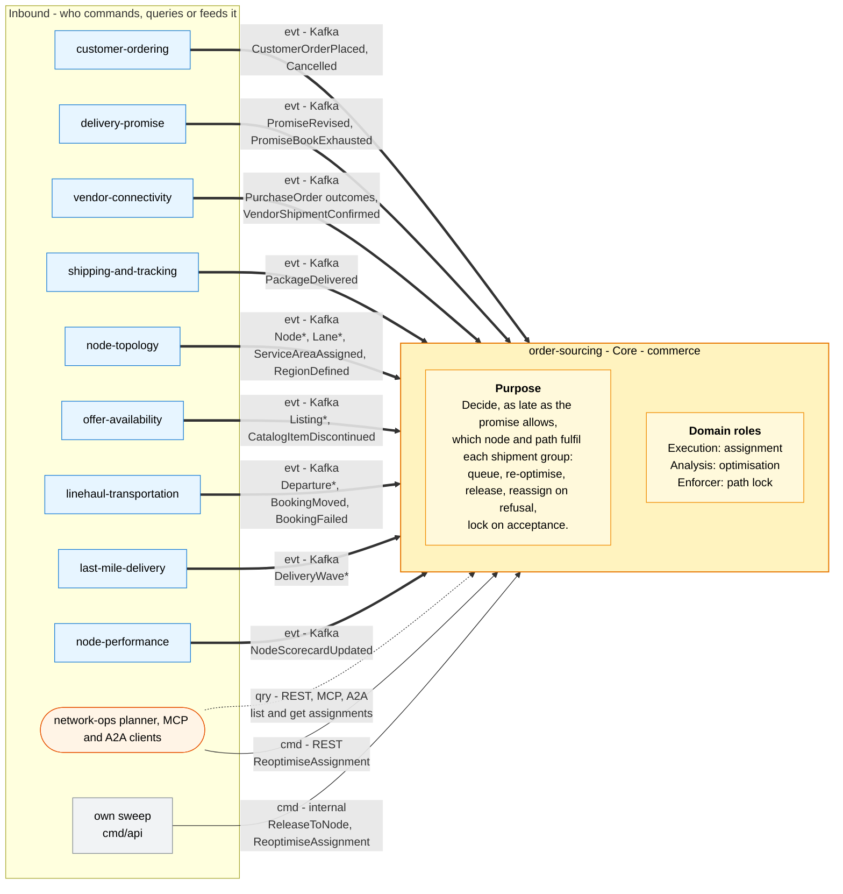
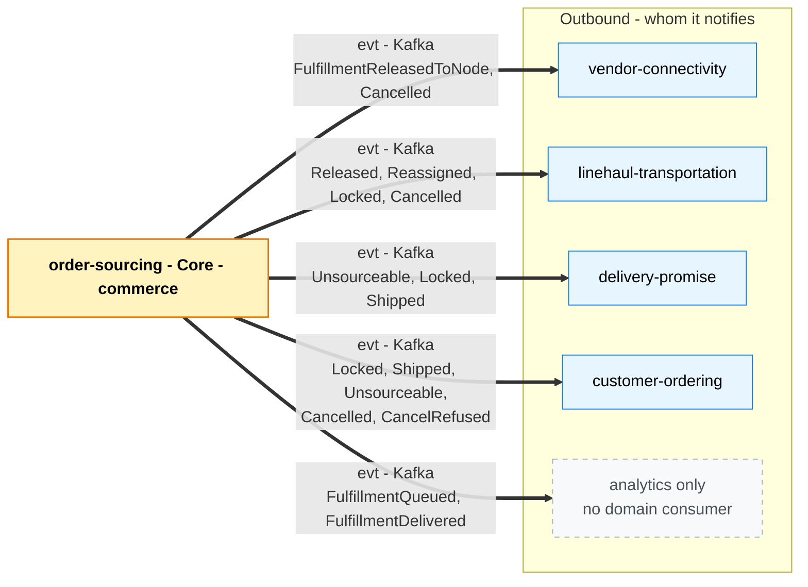

# Bounded context canvas

Following the ddd-crew [Bounded Context Canvas v5](https://github.com/ddd-crew/bounded-context-canvas). Every message row below is
a handler or an event in the code on `develop`; the exact types and `data` fields are on the
[event catalogue](/docs/api-reference/events).

## Canvas at a glance

Inbound collaborators feed the context (purpose, roles, business decisions), then the outbound ones it notifies. Solid arrows are
commands, dotted arrows queries, thick arrows events; each names its channel and messages.

### Inbound

Source: `internal/adapters/inbound/kafka/handlers.go` (`Handlers.Topics`), `internal/adapters/inbound/http/server.go`,
`internal/adapters/inbound/mcp/tools.go`, `internal/adapters/inbound/a2a/skills.go`, `cmd/api/main.go` (`startSweep`).

### Outbound

Source: `internal/adapters/outbound/kafka/encoder.go`, `internal/domain/assignment/events.go`; the consumer lists are read from the
four downstream handler files named on [Integration](/docs/ecosystem/integration). There are no outbound commands or queries: this
context calls no other context synchronously.

## Name

**Order Sourcing** (`order-sourcing`, code `OS`, CloudEvents tier `commerce`).

## Purpose

To decide, as late as the promise allows, which node and path will actually fulfil each shipment group. The context keeps one
`FulfillmentAssignment` per shipment group in a virtual queue, re-optimises queued assignments against current capacity and cost,
releases the group to one node at the release point (a purchase order through `vendor-connectivity`), reassigns on rejection or
expiry excluding the refusing node, locks once the node commits, and hands an impossible group back to `delivery-promise` as
unsourceable. It holds no PII and calls no other context synchronously.

## Strategic classification

| Axis | Verdict |
| --- | --- |
| **Domain** | **Core**. See the [Core domain chart](/docs/ddd/core-domain-chart) and [Subdomain classification](/docs/ddd/subdomain-classification). |
| **Business model** | Cost reducer (cost-to-serve) and speed protector. |
| **Evolution** | Custom-built. |

## Domain roles

| Role | Applies? | Evidence in the code |
| --- | --- | --- |
| **Execution (assignment)** | Yes, primary | Owns the `FulfillmentAssignment` lifecycle: `QueueAssignment`, `ReleaseToNode`, `HandleNodeRefusal`, `LockAssignment`, `MarkShipped`, `MarkDelivered`, `CancelAssignment`, `ApplyRevisedPromise` ([Use cases](/docs/ddd/use-cases)) |
| **Analysis (optimisation)** | Yes | `ReoptimiseAssignment` and the pure search `sourcing.Search` over five event-fed read models |
| **Enforcer (path lock)** | Yes | `ErrAssignmentLocked`, `ErrCancelAfterLock`, `ErrNodeExcluded`, `ErrReleaseInFlight` in `internal/domain/assignment/errors.go` |

## Inbound communication

| Collaborator | Messages | Type | Channel | Relationship |
| --- | --- | --- | --- | --- |
| `customer-ordering` | `CustomerOrderPlaced`, `CustomerOrderCancelled` | Event | Kafka `retailnetwork.customer-ordering.events` | Customer/Supplier |
| `delivery-promise` | `PromiseRevised`, `PromiseBookExhausted` | Event | Kafka `retailnetwork.delivery-promise.events` | Customer/Supplier |
| `vendor-connectivity` | `PurchaseOrderAccepted`, `PurchaseOrderRejected`, `PurchaseOrderExpired`, `VendorShipmentConfirmed` | Event | Kafka `retailnetwork.vendor-connectivity.events` | Customer/Supplier |
| `shipping-and-tracking` | `PackageDelivered` | Event | Kafka `retailnetwork.shipping-and-tracking.events` | Conformist |
| `node-topology` | `NodeRegistered`, `NodeOperationalProfileDeclared`, `NodeActivated`, `NodeSuspended`, `NodeRetired`, `LaneOpened`, `LaneClosed`, `ServiceAreaAssigned`, `RegionDefined` | Event | Kafka `retailnetwork.node-topology.events` | Conformist |
| `offer-availability` | `ListingCreated`, `ListingAvailabilityChanged`, `ListingSuppressed`, `ListingRestored`, `CatalogItemDiscontinued` | Event | Kafka `retailnetwork.offer-availability.events` | Conformist |
| `linehaul-transportation` | `DepartureScheduled`, `DepartureCapacityChanged`, `DepartureCancelled`, `BookingMoved`, `BookingFailed` | Event | Kafka `retailnetwork.linehaul-transportation.events` | Conformist |
| `last-mile-delivery` | `DeliveryWaveScheduled`, `DeliveryWaveCapacityChanged`, `DeliveryWaveCancelled` | Event | Kafka `retailnetwork.last-mile-delivery.events` | Conformist |
| `node-performance` | `NodeScorecardUpdated` | Event | Kafka `retailnetwork.node-performance.events` | Conformist |
| Network-ops planner, agents | `ListAssignments`, `GetAssignment` | Query | REST `GET /assignments`, `GET /assignments/{id}`; MCP `list_assignments`, `get_assignment`; A2A `find_assignments`, `assignment_detail` | Open Host (UI) |
| Network-ops planner | `ReoptimiseAssignment` | Command | REST `POST /assignments/{id}:reoptimise` | Open Host (UI) |
| Own sweep | `ReleaseToNode`, `ReoptimiseAssignment` | Command | in-process timer, `SWEEP_INTERVAL` | Internal |

## Outbound communication

All events: source `/retailnetwork/order-sourcing`, subject and Kafka key `assignmentId`, `dataschema`
`urn:retailnetwork:order-sourcing:<stream>:<EventName>:v1`.

| Collaborator | Message | Topic | Relationship |
| --- | --- | --- | --- |
| none (analytics only) | `FulfillmentQueued`, `FulfillmentDelivered` | `retailnetwork.order-sourcing.analytics` | Published Language |
| `vendor-connectivity`, `linehaul-transportation` | `FulfillmentReleasedToNode` | `retailnetwork.order-sourcing.events` | Customer/Supplier |
| `linehaul-transportation` | `FulfillmentReassigned` | events | Customer/Supplier |
| `delivery-promise`, `customer-ordering`, `linehaul-transportation` | `FulfillmentLocked` | events | Customer/Supplier; Conformist (`customer-ordering`) |
| `delivery-promise`, `customer-ordering` | `FulfillmentShipped` | events | Conformist |
| `delivery-promise`, `customer-ordering` | `FulfillmentUnsourceable` | events | Customer/Supplier (`delivery-promise`); Conformist (`customer-ordering`) |
| `vendor-connectivity`, `linehaul-transportation`, `customer-ordering` | `FulfillmentCancelled` | events | Customer/Supplier |
| `customer-ordering` | `FulfillmentCancelRefused` | events | Conformist |
| none found | `FulfillmentConstraintRevised` | events | Published Language |
| none | no synchronous call | n/a | n/a |

## Ubiquitous language

Full glossary: [Ubiquitous language](/docs/ddd/ubiquitous-language). Top terms: **Fulfillment assignment**, **Virtual queue**,
**Release**, **Path lock**, **Reassignment**, **Unsourceable**, and the value objects **Promise constraint**, **Candidate**,
**Release record**, **Excluded node**.

## Business decisions

1. **The assigned node may differ from the witness node.** The only hard constraint is that the candidate still meets
   `deliverByLatest` (`ErrCandidateBreaksPromise`).
2. **Free while queued, constrained after release, final after acceptance.** `Reoptimise` works only in `QUEUED`; after release
   the node changes only through `RefuseRelease`; after `PurchaseOrderAccepted` the assignment is `LOCKED`.
3. **Fill-or-kill.** A group goes to one node in full; at most one release is pending (`ErrReleaseInFlight`).
4. **Never break a promise silently.** No node left means `UNSOURCEABLE` and `FulfillmentUnsourceable`; a revised promise
   re-searches (`ApplyRevisedPromise`).
5. **In-region first.** Cross-region costs 1000 points; it is a penalty, not a filter.
6. **A refusing node is excluded** for the current promise revision (`ErrNodeExcluded`); a higher `revisionNo` resets the list.
7. **Release late, but in time to be acknowledged:** best pickup cutoff minus handling time minus 30 minutes; `SAME_DAY` at once.
8. **Cancel only before the lock;** later requests are refused with `FulfillmentCancelRefused`.

## Assumptions

- Every release goes to a vendor node: the search only considers active vendor-operated fulfilment centres, so every release
  becomes a purchase order issued by `vendor-connectivity`.
- `vendor-connectivity` echoes `assignmentId` and `releaseNo` on every purchase-order outcome, so a late outcome of an old release
  is recognised (`ErrReleaseNotPending`) and ignored.
- The read models have caught up before the first release after a start; they are fed only by events.
- `delivery-promise` answers `FulfillmentUnsourceable` with a revised promise or judges the promise broken later.

## Verification metrics

| Metric | Computed from | Why |
| --- | --- | --- |
| Groups by outcome | `sourcing.groups.sourced` by `outcome` and `reason` (see [Observability](/docs/operations/observability)) | Share created `unsourceable` or `failed` |
| First-release lock rate | first `FulfillmentReleasedToNode` (`releaseNo` 1) followed by `FulfillmentLocked` | Quality of the ranking and of node declarations |
| Reassignments per 1,000 groups | `FulfillmentReassigned` by `reason` | Vendor reliability versus queue churn |
| Non-witness assignment share | `FulfillmentLocked.nodeId` differs from `witnessNodeId` | How much late optimisation is used |
| Release lateness p95 | log `queue sweep` and `releasedAt` minus `releaseAt` | The queue fires on time |
| Stale-version conflicts | 409 `stale-assignment-version`, `concurrent-update` | Contention between sweep, consumers and the planner |

Of these only the first is an instrument in the service; the others are derived from the event stream.

## Open questions

Resolved by the build (the aggregator's earlier canvas listed them as gaps):

- `ApplyRevisedPromise` raises `FulfillmentConstraintRevised` and works in every non-terminal state; exclusions reset with the
  higher `revisionNo` ([ADR 0002](/docs/adr/0002-aggregates-invariants-and-assumptions) A9, A10).
- An `UNSOURCEABLE` assignment can be cancelled; a cancel after the lock is refused with `FulfillmentCancelRefused`.
- A group with no candidate is `UNSOURCEABLE` at once, so there is no `releaseAt` without a candidate.
- A multi-package group is `DELIVERED` when its last package is.
- Reason vocabularies are fixed in [ADR 0004](/docs/adr/0004-cloudevents-envelope-and-type-catalogue).

Still open:

- **Acceptance after cancellation.** A `PurchaseOrderAccepted` for a `CANCELLED` assignment is `ErrIllegalTransition`; the consumer
  logs it and acknowledges. Nothing undoes the vendor's acceptance, so the vendor may still ship a cancelled group.
- **Promise-book capacity stays on the witness node.** When the assignment moves, nothing moves the hold.
- **Book pressure only rises.** No event says a book has room again; the penalty applies until the departure passes.
- **A cancelled pickup departure after the lock.** `BookingMoved` repoints a locked assignment; nothing handles a cancelled
  departure for a locked one.
- **Soft versus hard cross-region rule.** Business decision 5 reads as a filter; the code applies a penalty.
