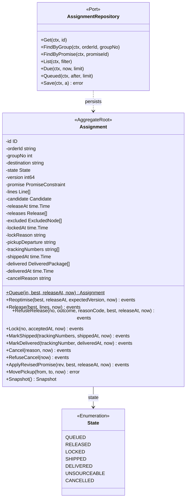
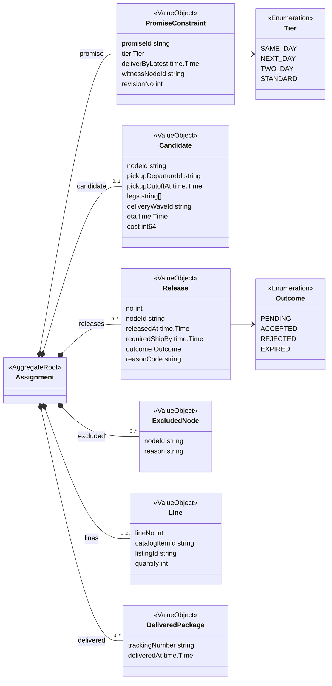
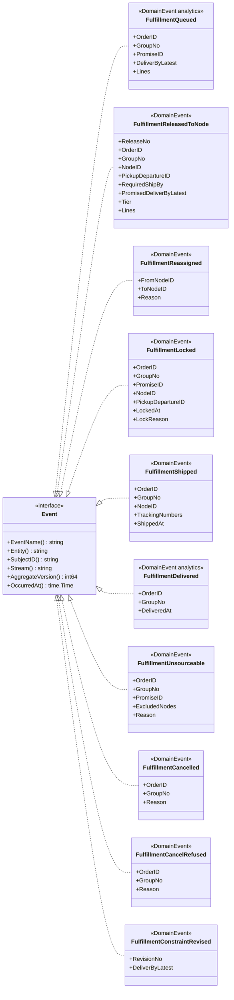
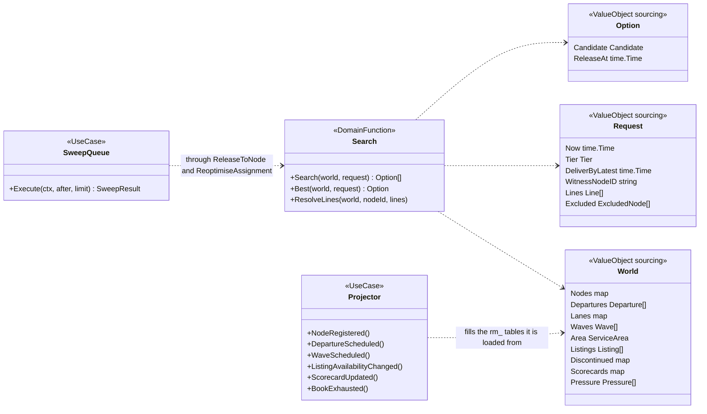
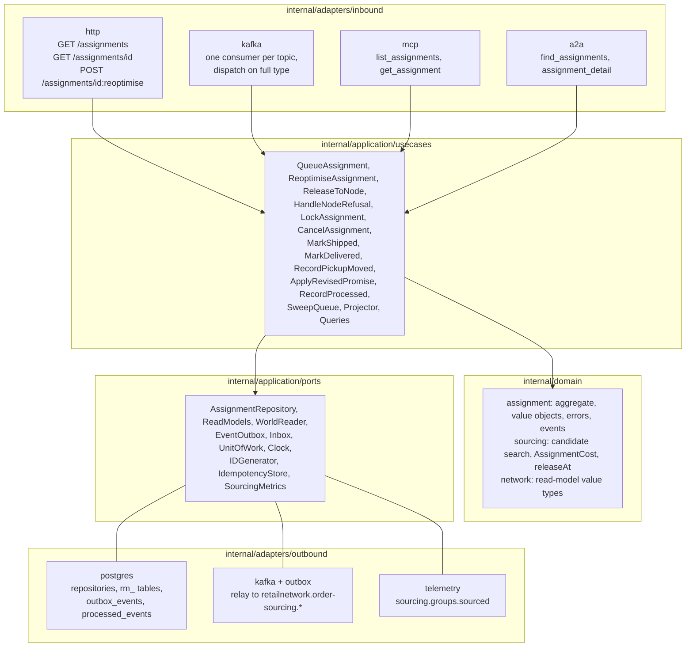

# Class diagram

Go types of `internal/domain` and `internal/application` as they are on `develop`. Fields are unexported in Go and shown with
`-`; methods are shown with `+`. Names are the code's; Go signatures are abbreviated.

## 1. FulfillmentAssignment aggregate

The root, its state and its repository first; then its value objects and enumerations.

Source: `internal/domain/assignment/types.go`, `assignment.go`, `commands.go`, `snapshot.go`, `internal/application/ports/ports.go`.
The aggregate is rebuilt from the database only through `Restore(Snapshot)`, which re-validates every invariant. The six model invariants are the errors `ErrCandidateBreaksPromise`, `ErrAssignmentLocked`, `ErrNodeExcluded`,
`ErrReleaseInFlight`, `ErrStaleAssignmentVersion` and `ErrCancelAfterLock`; `ErrReleaseNotPending` and `ErrStaleRevision`
are additional ones (`errors.go`).

## 2. Domain events

Source: `internal/domain/shared/shared.go` (`Event`), `internal/domain/assignment/events.go`. Every event embeds `Base`
(`assignmentId`, the aggregate version after the change and the instant); `SubjectID()` returns the `assignmentId`, which becomes
the CloudEvents `subject` and the Kafka key. Only `FulfillmentQueued` and `FulfillmentDelivered` override `Stream()` to the
analytics stream. Wire field names are on the [event catalogue](/docs/api-reference/events).

## 3. The search, the read-model types and the use cases

Source: `internal/domain/sourcing/sourcing.go`, `internal/domain/network/network.go` (`Node`, `Lane`, `Departure`, `Wave`,
`ServiceArea`, `Region`, `Listing`, `Scorecard`, `Pressure`), `internal/application/usecases/projector.go`, `sweep.go`. The weights
and the 30 minute ack budget are the constants `LegCost`, `HourCost`, `CrossRegionPenalty`, `BookPressurePenalty` and `AckBudget`.
`ReassignOnRefusal` and `LockOnCommit` of the design are not classes: they are the Kafka handlers calling `HandleNodeRefusal`
and `LockAssignment`.

## 4. Hexagonal ports and adapters

Source: `internal/application/ports/ports.go`, the package layout under `internal/adapters`, and `internal/architecture`
(`TestHexagonalArchitecture`). The in-memory repository (`outbound/memory`) is a test double and appears in no binary
(`TestRuntimeBinaryHasNoInMemoryAdapters`). There is no outbound HTTP client: the context calls no sibling. Path parameters are
written `id` inside the diagram. The layout and the rules are on [Architecture](/docs/overview/architecture).
