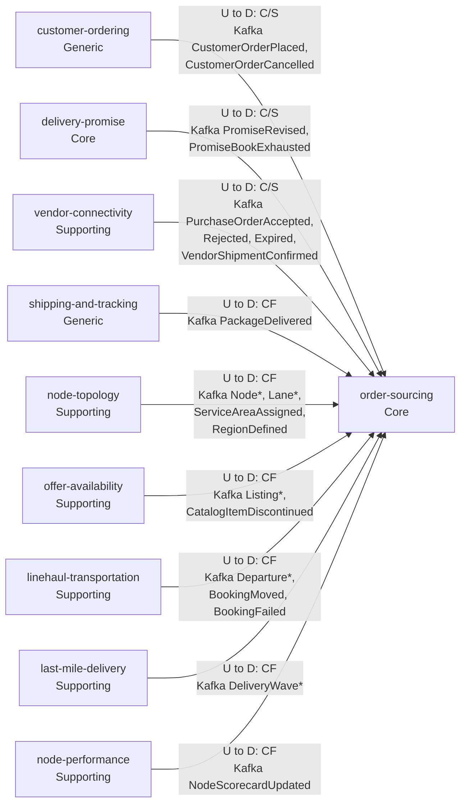
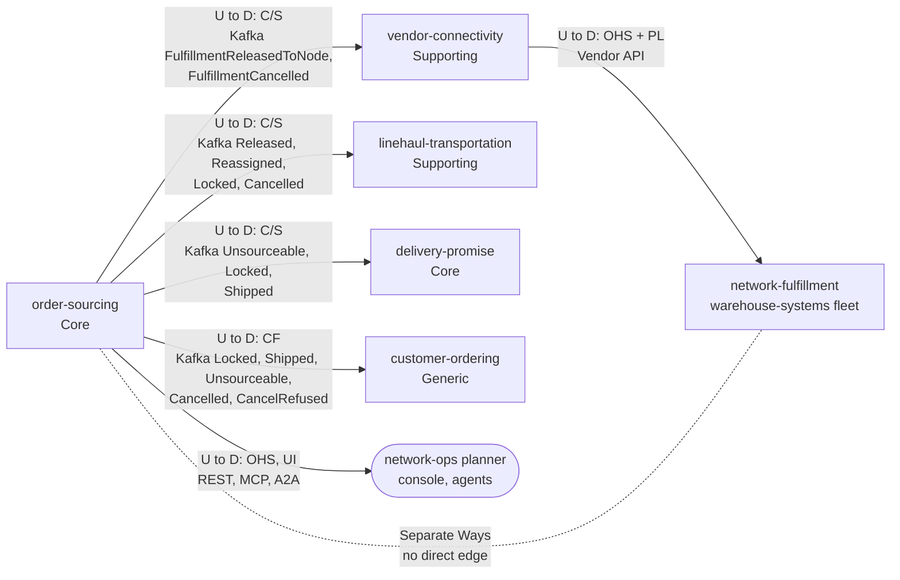

# Context map

Following ddd-crew [Context Mapping](https://github.com/ddd-crew/context-mapping). This is **order-sourcing's slice** of the
retail-network context map (in the aggregator,
[network context map](https://iqvo.github.io/warehouse-docs/network/strategic-design/context-map)): every relationship this
context has, with the upstream (U) and downstream (D) side, the pattern and the channel. Four neighbours appear on both sides:
this context consumes from them and they consume from it. The pattern of each direction is the one the **downstream** side
declares. The status of every edge in code is on [Integration](/docs/ecosystem/integration).

## Upstream of order-sourcing

Source: `internal/adapters/inbound/kafka/handlers.go` (`Handlers.Topics`: nine topics, nine consumer groups). Classification labels
come from the aggregator's network table, see [Subdomain classification](/docs/ddd/subdomain-classification).

## Downstream of order-sourcing

Source: `internal/domain/assignment/events.go` and `internal/adapters/outbound/kafka/encoder.go` (what is published), the four
downstream handler files listed on [Integration](/docs/ecosystem/integration) (who reads it), `internal/adapters/inbound/http`,
`mcp`, `a2a` (the planner surface). The `vendor-connectivity` to `network-fulfillment` edge is drawn only to show where the fleet
sits; it is not this context's relationship.

Legend: solid arrows point from upstream to downstream; the dotted line without an arrow head is a deliberately absent
relationship. `C/S` Customer/Supplier, `CF` Conformist, `OHS` Open Host Service, `PL` Published Language.

Omitted: analytics-only events (`FulfillmentQueued`, `FulfillmentDelivered`, no known consumer), `FulfillmentConstraintRevised`
(no consumer found), Postgres and Kafka as infrastructure, and the future contexts (`customer-returns`, `customer-notification`,
`payments-and-invoicing`), which have no edge here.

## Relationships

| Neighbour | Direction | Pattern | Channel | Messages | Why this pattern |
| --- | --- | --- | --- | --- | --- |
| `customer-ordering` (Generic) | U to OS | Customer/Supplier | Kafka `retailnetwork.customer-ordering.events` | `CustomerOrderPlaced`, `CustomerOrderCancelled` | Sourcing needs every group with its promise constraint (`groupNo`, `promiseId`, `tier`, `witnessNodeId`, `deliverByLatest`, `lines`); the event shape is negotiated for this consumer. |
| `customer-ordering` (Generic) | OS to U | Conformist (customer-ordering conforms) | Kafka `retailnetwork.order-sourcing.events` | `FulfillmentLocked`, `FulfillmentShipped`, `FulfillmentUnsourceable`, `FulfillmentCancelled`, `FulfillmentCancelRefused` | It reflects sourcing facts into its status and tracking view and takes them as published. |
| `delivery-promise` (Core) | U to OS | Customer/Supplier | Kafka `retailnetwork.delivery-promise.events` | `PromiseRevised`, `PromiseBookExhausted` | The re-promise answers `FulfillmentUnsourceable`; book exhaustion feeds the 500 point book-pressure term. |
| `delivery-promise` (Core) | OS to U | Customer/Supplier | Kafka `retailnetwork.order-sourcing.events` | `FulfillmentUnsourceable`, `FulfillmentLocked`, `FulfillmentShipped` | The two Core contexts form a loop: unsourceable, re-promise, re-queue ([ADR 0001](/docs/adr/0001-order-sourcing-bounded-context)). |
| `vendor-connectivity` (Supporting) | OS to U | Customer/Supplier | Kafka `retailnetwork.order-sourcing.events` | `FulfillmentReleasedToNode`, `FulfillmentCancelled` | It turns a release into a purchase order (idempotent on `assignmentId` + `releaseNo`) and cancels it on `FulfillmentCancelled`. |
| `vendor-connectivity` (Supporting) | U to OS | Customer/Supplier | Kafka `retailnetwork.vendor-connectivity.events` | `PurchaseOrderAccepted`, `PurchaseOrderRejected`, `PurchaseOrderExpired`, `VendorShipmentConfirmed` | The outcomes carry `assignmentId` and `releaseNo` for this consumer; acceptance is the path lock. |
| `linehaul-transportation` (Supporting) | U to OS | Conformist | Kafka `retailnetwork.linehaul-transportation.events` | `DepartureScheduled`, `DepartureCapacityChanged`, `DepartureCancelled`, `BookingMoved`, `BookingFailed` | Departures are linehaul's published facts; they feed the departures read model. |
| `linehaul-transportation` (Supporting) | OS to U | Customer/Supplier | Kafka `retailnetwork.order-sourcing.events` | `FulfillmentReleasedToNode`, `FulfillmentReassigned`, `FulfillmentLocked`, `FulfillmentCancelled` | Linehaul expects volume and books the pickup on lock. |
| `shipping-and-tracking` (Generic) | U to OS | Conformist | Kafka `retailnetwork.shipping-and-tracking.events` | `PackageDelivered` | A tracking fact, taken as published; drives `MarkDelivered`. |
| `node-topology` (Supporting) | U to OS | Conformist | Kafka `retailnetwork.node-topology.events` | `Node*`, `Lane*`, `ServiceAreaAssigned`, `RegionDefined` (9 types) | Master data of the network's shape. |
| `offer-availability` (Supporting) | U to OS | Conformist | Kafka `retailnetwork.offer-availability.events` | `Listing*` (4 types), `CatalogItemDiscontinued` | Which node can ship which item and the `listingId` a release must carry. |
| `last-mile-delivery` (Supporting) | U to OS | Conformist | Kafka `retailnetwork.last-mile-delivery.events` | `DeliveryWaveScheduled`, `DeliveryWaveCapacityChanged`, `DeliveryWaveCancelled` | Wave capacity for the last leg of a candidate. |
| `node-performance` (Supporting) | U to OS | Conformist | Kafka `retailnetwork.node-performance.events` | `NodeScorecardUpdated` | Measured performance feeds the scorecard penalty. |
| Network-ops planner, console, agents | OS to planner | Open Host (UI) | REST `/assignments`; MCP `/mcp`; A2A `/a2a` | list, get, re-optimise (REST only) | An operator and agent surface; no auth. |
| `network-fulfillment` (warehouse-systems fleet) | none | Separate Ways | none | none | The hard boundary: no retail-network context calls a fleet service or reads a fleet topic. The fleet reaches this context's decisions only as purchase orders it polls from `vendor-connectivity`'s Vendor API. |

## Notes on the patterns

- **Customer/Supplier both ways with `delivery-promise`.** Not a Shared Kernel: no model element is shared. The promise constraint
  crosses as fields inside `CustomerOrderPlaced`, and the loop closes with `FulfillmentUnsourceable` and `PromiseRevised`.
- **Conformist to the logistics and partner master data.** Topology, availability, departures, waves and scorecards are consumed
  as published into local read models; their owners do not adapt to this context.
- **No synchronous dependency.** Every decision is made from local, event-fed read models, so a neighbour outage delays freshness,
  never a release.
- **No Anti-Corruption Layer is needed.** Every neighbour speaks the same network language; the ACL toward the fleet lives in the
  fleet, behind `vendor-connectivity`.
