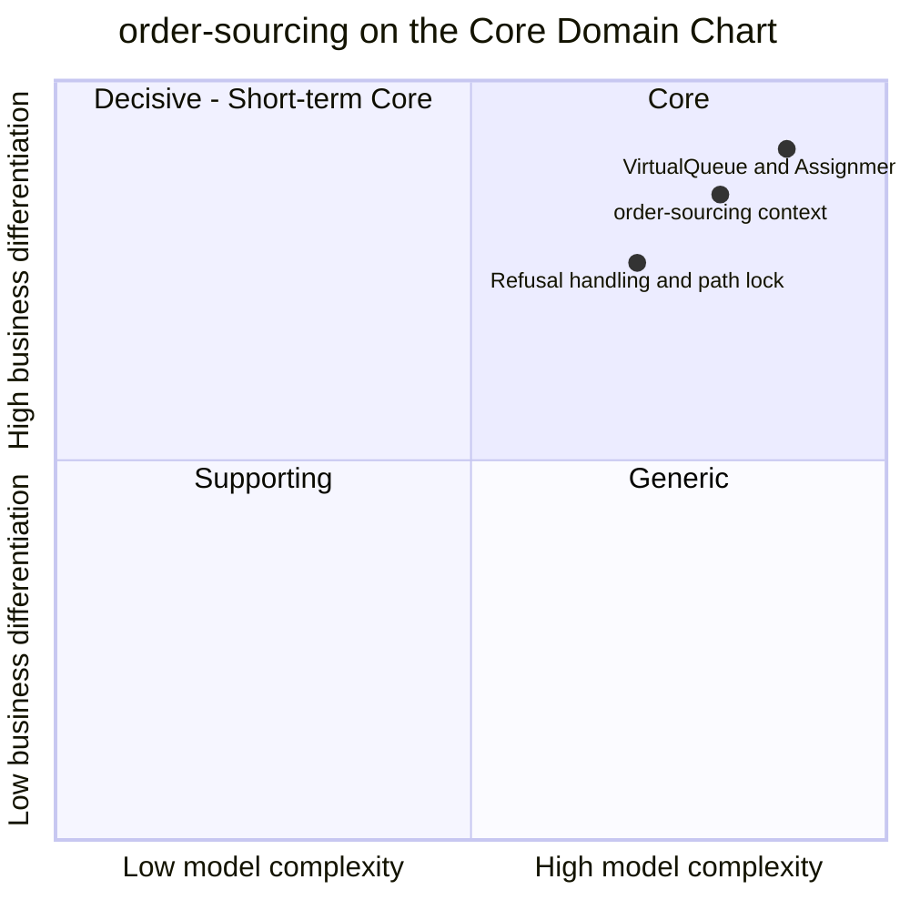

# Core domain chart

Following the ddd-crew [Core Domain Charts](https://github.com/ddd-crew/core-domain-charts): business differentiation (y)
against model complexity (x).

Source: positions from the aggregator's `network/docs/contexts/order-sourcing/core-domain-chart.md` (`origin/main`, model
`complexity: 0.8`, `differentiation: 0.85`); the two slice positions are an estimate of that page, the model gives a position
only for the context. The slices are the code in `internal/domain/sourcing/sourcing.go` (search, cost, release point) and
`internal/domain/assignment/commands.go` (refusal, lock).

`delivery-promise`, the other Core context of the network, sits higher and further right in the aggregator's network chart; the
other contexts' positions are on that network chart.

## Classification: Core

All three points sit in **quadrant 1 (Core)**, top right. The context is classified `Core`, business model *cost-to-serve reducer
and speed protector*, evolution *custom-built* ([Subdomain classification](/docs/ddd/subdomain-classification)).

### Why differentiation is high

- Sourcing decides **cost-to-serve** for every package the network ships: the node, the legs, whether the group crosses a region.
  The promise fixes what the shopper is told; sourcing decides what it costs to keep it.
- It is the network's **speed protector**. A group that its first node refuses is moved, not dropped, and an impossible group
  becomes `UNSOURCEABLE` and is handed back for a re-promise instead of breaking the promise silently.
- The highest slice, **VirtualQueue and AssignmentCost**, is where the differentiating knowledge lives: when to release
  (`releaseAt` = pickup cutoff minus the node's handling time minus a 30 minute vendor ack budget, never before now) and how to
  rank candidates (100 per leg, 10 per hour of wait, 1000 cross-region, a scorecard penalty, 500 for book pressure; ties go to the
  witness node). See [Use cases](/docs/ddd/use-cases#how-a-candidate-is-chosen).

### Why complexity is high

- One aggregate, but a rich one: seven states, eleven aggregate commands (`Queue`, `Reoptimise`, `Release`, `RefuseRelease`,
  `Lock`, `MarkShipped`, `MarkDelivered`, `Cancel`, `RefuseCancel`, `ApplyRevisedPromise`, `MovePickup`) and six model invariants
  plus two consumer-facing ones (`ErrReleaseNotPending`, `ErrStaleRevision`), ten published events.
- It reacts to 32 consumed event types from nine topics and keeps five event-fed views in ten `rm_*` tables, because it calls no
  sibling.
- Two loops cross context boundaries: release, purchase order, acceptance, rejection or expiry with `vendor-connectivity`;
  unsourceable, re-promise, re-queue with `delivery-promise`. Each has races (a stale purchase-order outcome, a cancellation that
  crosses an acceptance) the aggregate must absorb.
- The **Refusal handling and path lock** slice is plotted slightly lower: its rules are crisp (`ErrNodeExcluded`,
  `ErrReleaseInFlight`, `ErrAssignmentLocked`), but they keep every candidate decision honest once a vendor is involved.

## Evolution

| Part | Evolution stage | Why |
| --- | --- | --- |
| `VirtualQueue`, `AssignmentCost`, candidate search | **Custom-built** (genesis at the edges) | Specific to this network's tiers, promise books and vendor ack budget. The weights are constants in code and will be tuned. |
| `FulfillmentAssignment` lifecycle (queue, release, refusal, lock) | **Custom-built** | The shape is known from order-management products; lock-on-acceptance is this network's rule ([ADR 0002](/docs/adr/0002-aggregates-invariants-and-assumptions)). |
| Event-fed read models | **Product** pattern | Standard projections of sibling events; no domain rule beyond newer-wins. |
| Outbox, inbox, CloudEvents | **Commodity** | Network-wide conventions ([ADR 0004](/docs/adr/0004-cloudevents-envelope-and-type-catalogue), [ADR 0005](/docs/adr/0005-outbox-relay-attempt-cap-sweep-and-shutdown)). |

**Movement to watch.** The weights and the ack budget are tunable numbers. If they settle into fixed defaults that rarely change,
parts of `AssignmentCost` could drift toward Product. The decision structure is what keeps the context Core.
