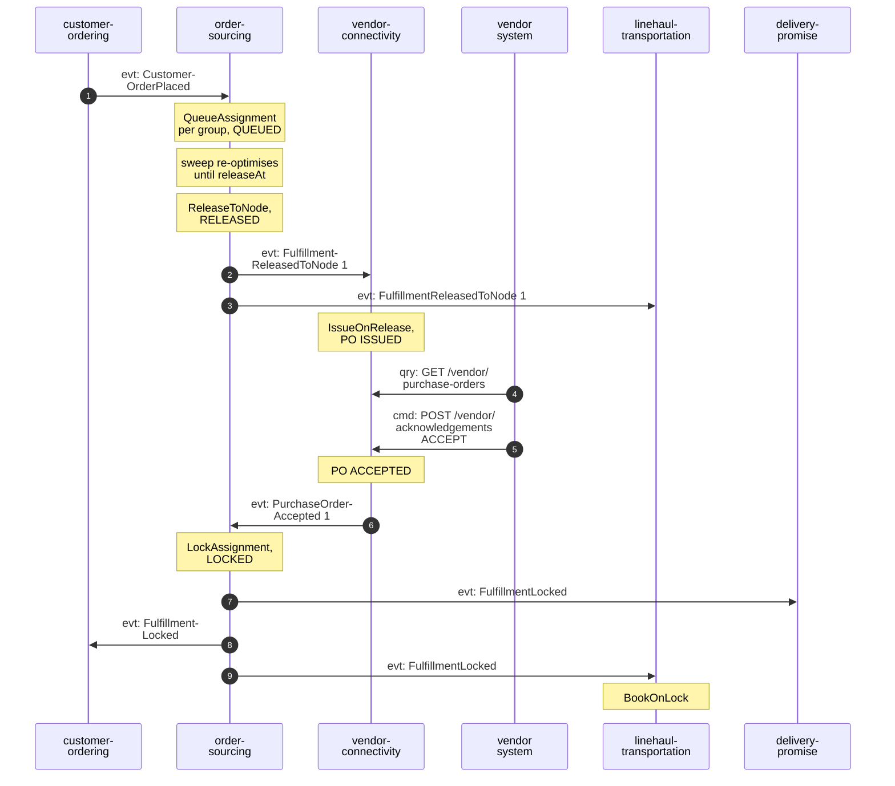
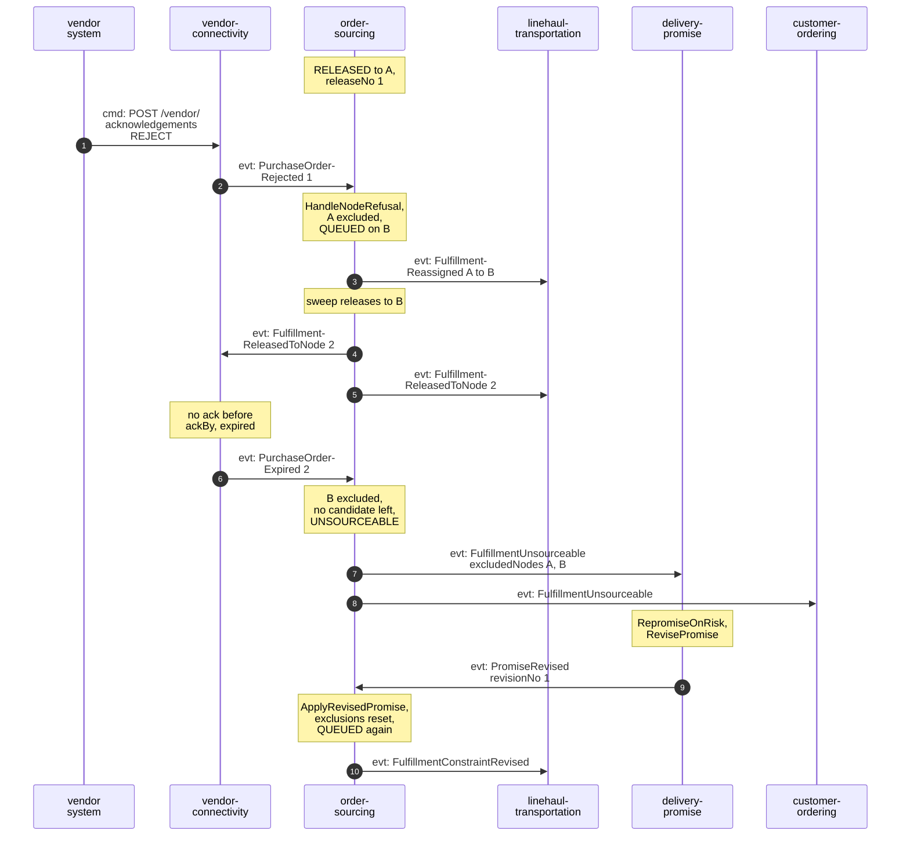
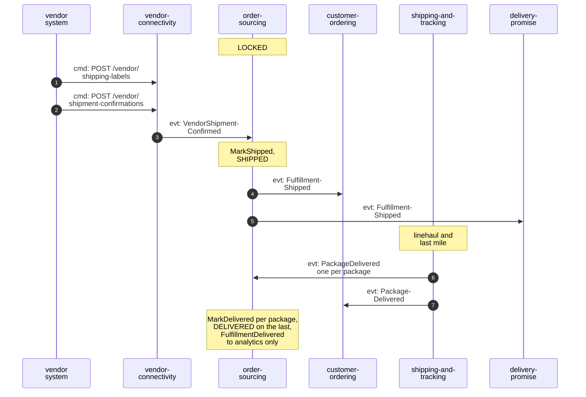
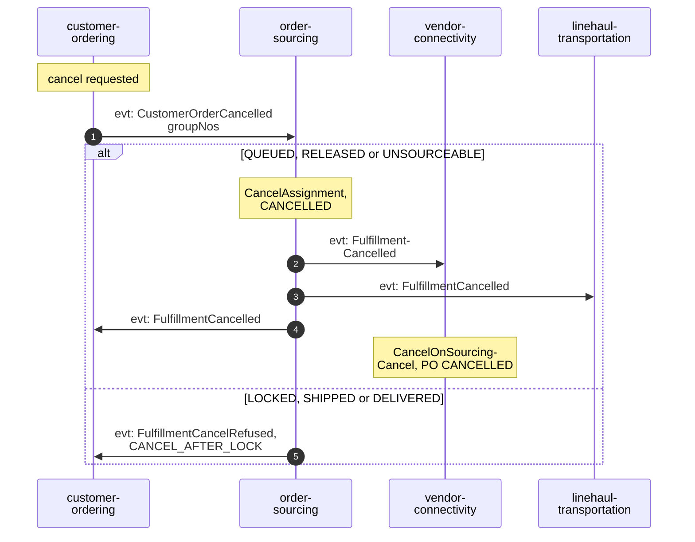

# Domain message flow

Following ddd-crew [Domain Message Flow Modelling](https://github.com/ddd-crew/domain-message-flow-modelling). Participants are
contexts and external systems. Every arrow is a message that exists in the code, prefixed `cmd:` (command), `qry:` (query) or
`evt:` (event). Commands handled inside this context are shown as notes, not arrows. The network-level view with worked times is
in the aggregator's [order assignment model](https://iqvo.github.io/warehouse-docs/network/network-model/order-assignment-model).

Event names are short; the full types are
`com.retailnetwork.commerce.order-sourcing.assignment.<EventName>` for this context and are on the
[event catalogue](/docs/api-reference/events). A number after a release or purchase-order event is its `releaseNo`; a hyphen at a
line end only wraps a long name (`Fulfillment-ReleasedToNode` is `FulfillmentReleasedToNode`).

Source for the flows: `internal/adapters/inbound/kafka/handlers.go` (what is consumed), `internal/domain/assignment/commands.go`
(what each command raises), the downstream handlers named on [Integration](/docs/ecosystem/integration). The vendor-side steps
(`vendor-connectivity` issuing and acknowledging the purchase order) are that context's and are shown as read from its design;
they are not in this repository.

## 1. Happy path: placed, queued, released, locked

Omitted: `FulfillmentQueued` (analytics only, raised with `QueueAssignment`). The vendor system is any vendor's integration; for
vendor `V-WS` it is the fleet's `network-fulfillment`, which talks only to `vendor-connectivity`. `SAME_DAY` groups skip the
sweeps: `ReleaseToNode` runs inside the same transaction as `QueueAssignment`. A `FulfillmentReassigned` is raised by a sweep that
changes the node before release (consumer `linehaul-transportation`).

## 2. Failure path: rejected, reassigned, expired, unsourceable, re-promised

Omitted: `PurchaseOrderRejected` and `PurchaseOrderExpired` are also read by `node-performance` for the scorecard. If nothing is
feasible even at the loosest tier, `delivery-promise` sends no `PromiseRevised`; it reports the promise broken later and
`customer-ordering` may cancel the group, which this context accepts for an `UNSOURCEABLE` assignment (`Cancel` allows it).
`FulfillmentConstraintRevised` is drawn with no known reader (no consumer was found in the four downstream clones, see
[Integration](/docs/ecosystem/integration)). If the revised promise yields no candidate, the assignment stays `UNSOURCEABLE`
silently, with no second `FulfillmentUnsourceable`.

## 3. Shipped and delivered

Omitted: label issuing inside the network, the loads and scans between handover and delivery, and `PackageDelivered` to
`delivery-promise` for the judgement. A `BookingMoved` from `linehaul-transportation` repoints the pickup departure of a `LOCKED`
assignment without any event of this context.

## 4. Customer cancels

Omitted: if the vendor's acceptance is already being processed when the cancellation lands, `vendor-connectivity` cannot cancel an
accepted purchase order (its own rule). An acceptance that reaches this context after it cancelled a `RELEASED` assignment is
`ErrIllegalTransition`, logged and acknowledged, so the vendor may still ship the group: the known residual on the
[bounded context canvas](/docs/ddd/bounded-context-canvas#open-questions).
