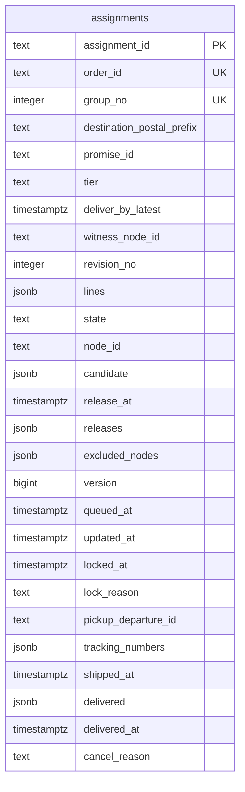
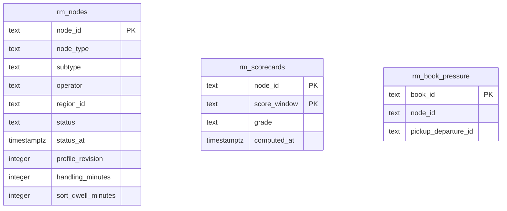
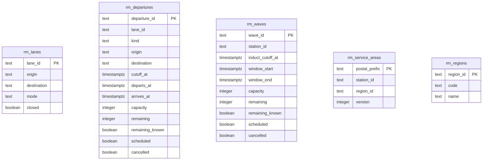
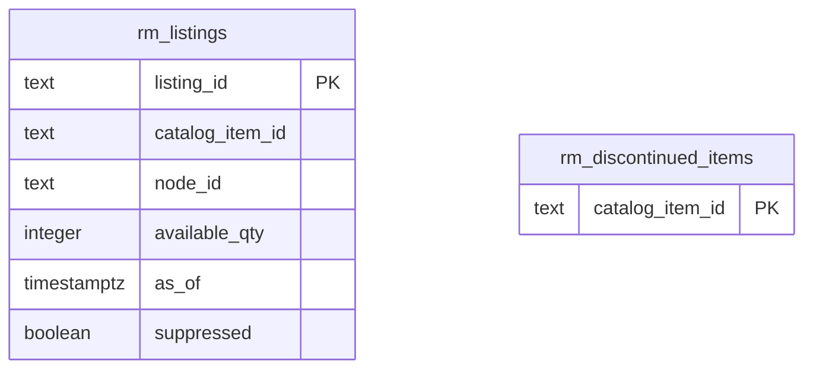
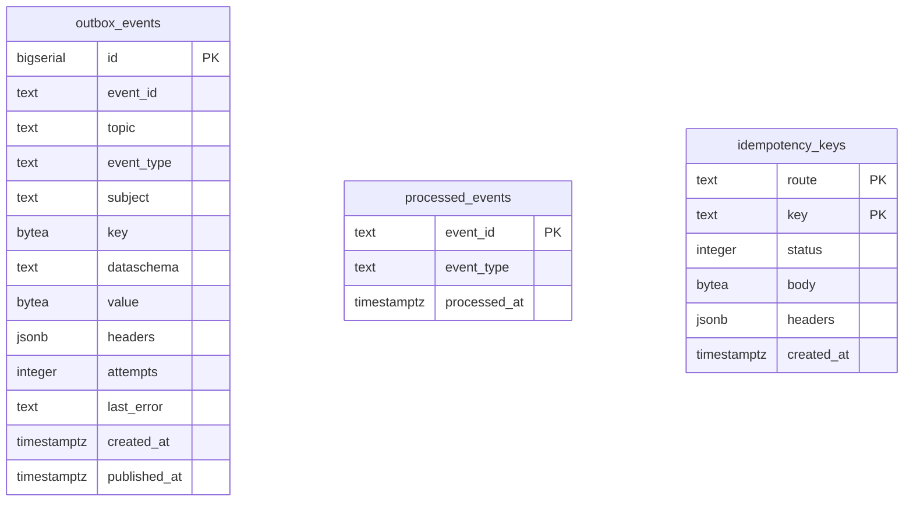

# Entity relationship

The schema of this context's own Postgres database ("every context owns its database; no shared tables"), exactly as created by
the single embedded migration `internal/adapters/outbound/postgres/migrations/0001_order_sourcing_schema.up.sql`, applied by
golang-migrate at every boot. There are **14 tables** and no foreign keys: the aggregate is one row with `jsonb` columns, the
read models are projections that can be dropped and replayed, and every id of another context is a plain value.

## FulfillmentAssignment (one table)

Source: the `assignments` table of the migration and `internal/domain/assignment/snapshot.go` (`Snapshot`).

Column notes:

- `(order_id, group_no)` is one unique key (`assignments_order_group_key`): one assignment per shipment group, and the reason a
  repeated `CustomerOrderPlaced` is a no-op. A violation is `ports.ErrDuplicateGroup`.
- `version` (CHECK at least 1) is the optimistic lock: every save expects the stored version to be the aggregate's version minus
  one (`ports.ErrConcurrentUpdate` otherwise). It is the `assignmentVersion` of the API.
- `lines`, `candidate`, `releases`, `excluded_nodes`, `tracking_numbers` and `delivered` are JSON documents that belong to the
  aggregate: lines, the current candidate (node, pickup departure and cutoff, legs, wave, eta, cost), the release history with each
  outcome, the exclusion list, the shipment's tracking numbers and the delivered packages. There are no child tables.
- `node_id` is the node of the candidate while `QUEUED` and of the latest release afterwards; it is what `GET /assignments?nodeId=`
  filters on. `state` is not constrained by a CHECK; the domain validates it.
- `destination_postal_prefix` is a postal prefix, not an address: no PII is stored here.
- Indexes: `assignments_promise_idx (promise_id)` for `FindByPromise`; `assignments_state_node_idx (state, node_id)` for the list
  filters; `assignments_queue_idx (release_at, assignment_id) WHERE state = 'QUEUED'` for the release timer and the
  re-optimisation sweep.

## Read-model tables

Fed only by sibling events, rebuilt by replaying their topics (an older instant or a lower revision never overwrites a newer
one). The five views map to ten tables.

Source: the `rm_*` tables of the migration; the projection rules are in `internal/domain/network/network.go` and
`internal/application/usecases/projector.go`.

| View | Tables | Event source |
| --- | --- | --- |
| `NodeProfileView` | `rm_nodes` | `node-topology` node events |
| `NetworkGraphView` | `rm_lanes`, `rm_departures`, `rm_waves`, `rm_service_areas`, `rm_regions` | `node-topology` (lanes, service areas, regions), `linehaul-transportation` (departures), `last-mile-delivery` (waves) |
| `AvailabilityView` | `rm_listings`, `rm_discontinued_items` | `offer-availability` |
| `ScorecardView` | `rm_scorecards` (`score_window` stands for the scorecard's `window`, a reserved word) | `node-performance`; only the `30d` window is used by the cost |
| `PromiseBookPressureView` | `rm_book_pressure` | `delivery-promise` `PromiseBookExhausted` |

`remaining_known` marks that `remaining` holds a real value: the schedule's capacity or a capacity event, and a later schedule
keeps the remaining value a capacity event already set. A row is usable only if `scheduled`, not `cancelled` and `remaining` is
above 0; a cancellation that arrives before the schedule is kept.

## Infrastructure tables

Source: the same migration. All three are infrastructure, not domain tables:

- `outbox_events` is written in the same transaction as the aggregate and drained by the relay. `value` is the already-encoded
  CloudEvents message, `event_id` its stable CloudEvents `id`; a partial index serves the unpublished rows by `id`. `attempts` and
  `last_error` support the attempt cap ([Runbook](/docs/operations/runbook#outbox-relay)).
- `processed_events` is the inbox: one row per consumed CloudEvents `id`, written in the same transaction as its effect.
- `idempotency_keys` stores the first answer of `POST /assignments/{id}:reoptimise` per `(route, key)`, ignored after 24 hours.

golang-migrate also keeps its own bookkeeping table (`schema_migrations`), created by the tool and not by this migration.

## No foreign key across aggregates or contexts

- `node_id`, `witness_node_id`, `promise_id`, `order_id`, `catalog_item_id`, `listing_id` and `pickup_departure_id` name entities
  of other contexts, which live in other databases, so they are values. A node retired in `node-topology` must not block a write
  here.
- The `rm_` tables are not joined to the aggregate by constraints either: a constraint would make a replay order-dependent.
- There is only one aggregate, so no cross-aggregate key exists.

## Table is not aggregate

| Table | Role |
| --- | --- |
| `assignments` | **FulfillmentAssignment** root, with its lines, release history and exclusions embedded as JSON |
| `rm_nodes`, `rm_lanes`, `rm_departures`, `rm_waves`, `rm_service_areas`, `rm_regions`, `rm_listings`, `rm_discontinued_items`, `rm_scorecards`, `rm_book_pressure` | read models; no invariant of this context |
| `outbox_events`, `processed_events`, `idempotency_keys` | infrastructure |
