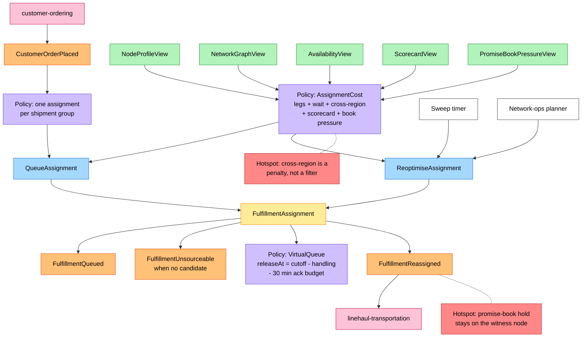
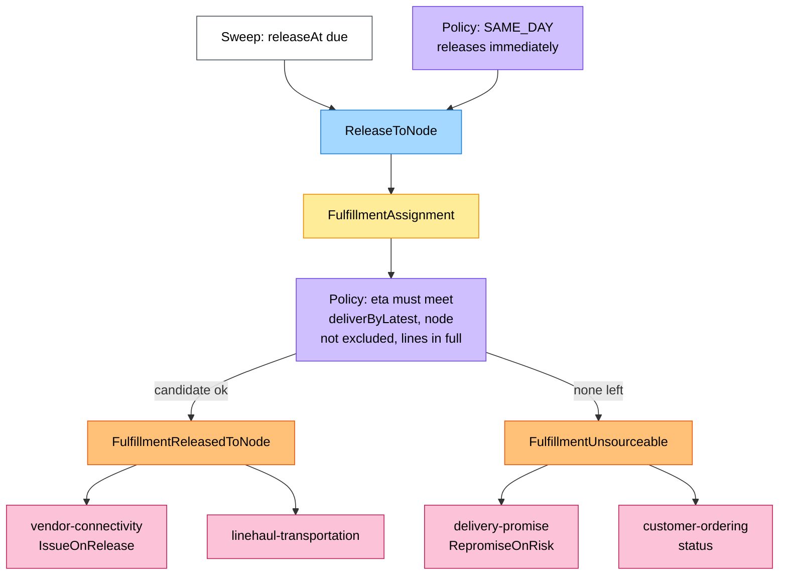
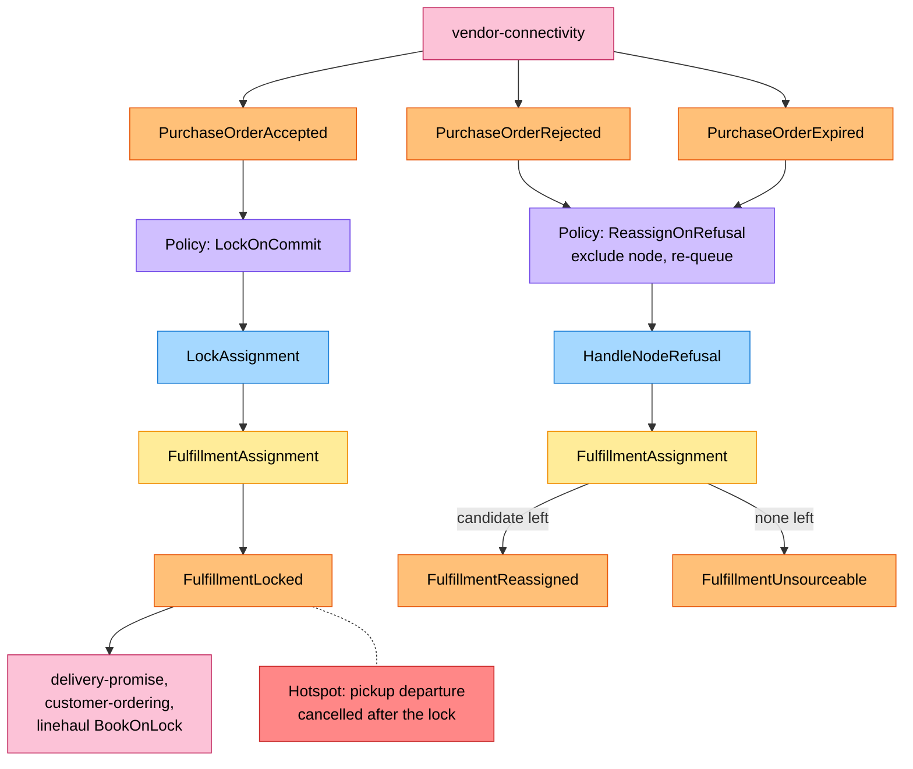
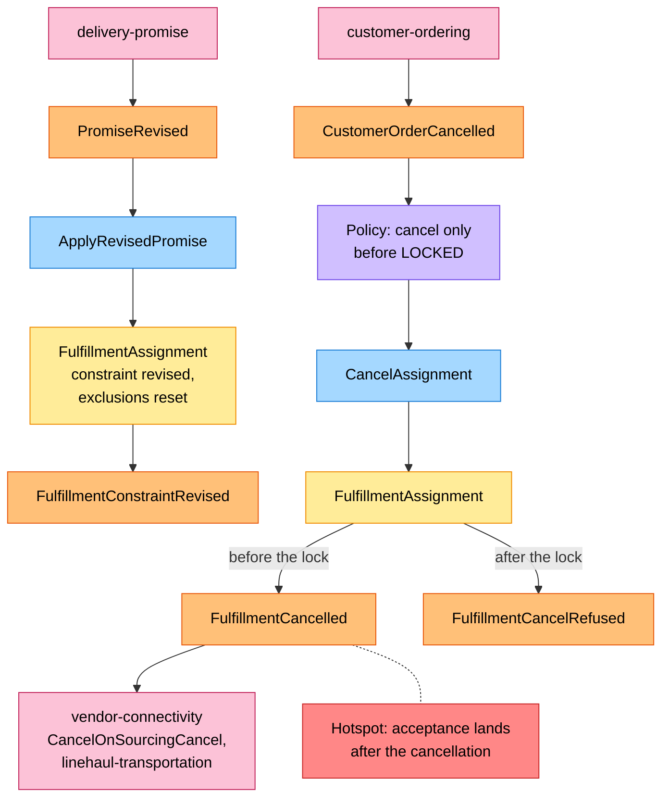
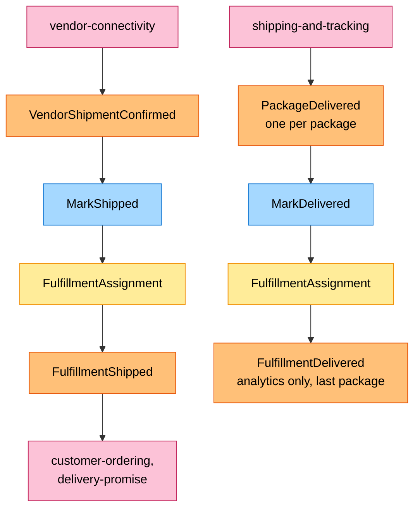

# EventStorming (process level)

Uses the ddd-crew [EventStorming glossary and cheat sheet](https://github.com/ddd-crew/eventstorming-glossary-cheat-sheet)
notation. Every sticky is an element of the code: a command of `FulfillmentAssignment`, an event in
`internal/domain/assignment/events.go` or a consumed type in `internal/adapters/inbound/kafka/handlers.go`. Events from other
contexts are orange stickies next to the pink system that publishes them. The aggregate sticky is repeated on each board so
lines do not cross. Hotspots are gaps or risks; the inventory at the end says which the build resolved.

## Legend

| Sticky | Colour | Meaning here |
| --- | --- | --- |
| Command | blue `#a5d8ff` | A command of `FulfillmentAssignment` |
| Aggregate | yellow `#ffec99` | `FulfillmentAssignment` |
| Domain event | orange `#ffc078` | An event this context publishes, or a neighbour event it consumes |
| Policy | lilac `#d0bfff` | A policy or a business rule |
| Read model | green `#b2f2bb` | One of the five read models |
| External system | pink `#fcc2d7` | A sibling context |
| Hotspot | red `#ff8787` | An open question or risk |
| Actor | white `#ffffff` | A person or this context's own timer |

## 1. Intake and the virtual queue

Source: `internal/adapters/inbound/kafka/handlers.go` (`CustomerOrdering`), `usecases/queue.go`, `usecases/search.go`,
`domain/sourcing/sourcing.go`, `domain/assignment/commands.go` (`Queue`, `Reoptimise`). Omitted: the 22 events that feed the five
read models ([Use cases](/docs/ddd/use-cases#the-projected-events-use-case-13)); a re-optimisation that keeps the same candidate,
which raises nothing.

## 2. Release

Source: `usecases/commands.go` (`ReleaseToNode`), `usecases/queue.go` (`releaseNow`), `domain/assignment/commands.go` (`Release`).
Omitted: `ErrReleaseInFlight` (a second release while one is pending), shown on
[Sequence diagrams](/docs/ddd/sequence-diagrams).

## 3. The node's answer: lock or refusal

Source: `usecases/commands.go` (`LockAssignment`, `HandleNodeRefusal`), `domain/assignment/commands.go` (`Lock`, `RefuseRelease`,
`pendingRelease`). The `releaseNo` of the outcome must be the pending release; an older outcome is logged and ignored.
`node-performance` also reads the three purchase-order events for the scorecard. `BookingMoved` repoints the pickup departure
of a locked assignment (`MovePickup`) without an event.

## 4. Re-promise and cancellation

Source: `usecases/cancel_revise.go`, `domain/assignment/commands.go` (`ApplyRevisedPromise`, `Cancel`, `RefuseCancel`).

## 5. Shipment and delivery

Source: `usecases/commands.go` (`MarkShipped`, `MarkDelivered`), `domain/assignment/commands.go`.

## Hotspot inventory

Resolved by the build (the aggregator's earlier boards listed them as open):

| Hotspot | Resolution in the code |
| --- | --- |
| No `releaseAt` when no candidate is left | A group with no candidate is `UNSOURCEABLE` at once, in `Queue`, `Reoptimise`, `Release` and `RefuseRelease` (`ReasonNoCandidate`, `ReasonNodeRefused`) |
| `ApplyRevisedPromise` raises no event | It always raises `FulfillmentConstraintRevised` |
| `UNSOURCEABLE` cannot be cancelled | `Cancel` allows `QUEUED`, `RELEASED` and `UNSOURCEABLE` |
| Exclusion per promise revision without `revisionNo` | `PromiseConstraint.RevisionNo`; a higher revision resets the list |
| Multi-package delivery | The group delivers when the last package does; each `PackageDelivered` is remembered |
| Revision of an assignment that is not `UNSOURCEABLE` | Applied in every non-terminal state; the node is only re-searched in `QUEUED` and `UNSOURCEABLE` |
| Destination not on the aggregate | `destinationPostalPrefix` is on the aggregate and in the table |

Still open:

| Hotspot | Where it comes from |
| --- | --- |
| Promise-book hold stays on the witness node | The assigned node may differ from the witness, but nothing moves the capacity hold on the `delivery-promise` side |
| Cross-region as penalty versus rule | Business decision 5 reads as a filter; `CrossRegionPenalty` is 1000 points |
| Acceptance after cancellation | A `PurchaseOrderAccepted` for a `CANCELLED` assignment is `ErrIllegalTransition` and only logged; the vendor may still ship |
| Pickup departure cancelled after the lock | `DepartureCancelled` updates the read model; no transition handles a locked assignment whose departure is gone |
