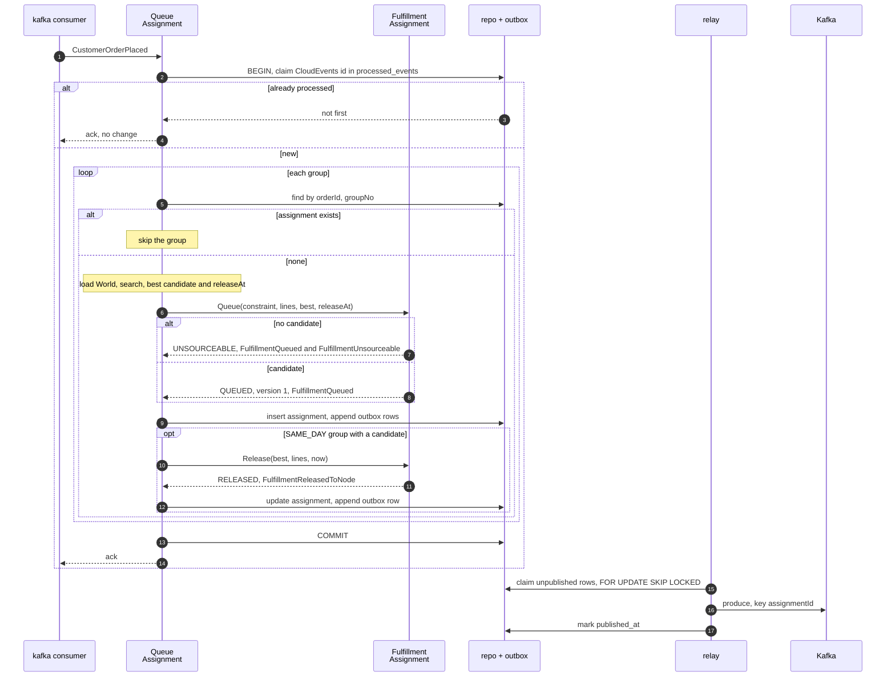
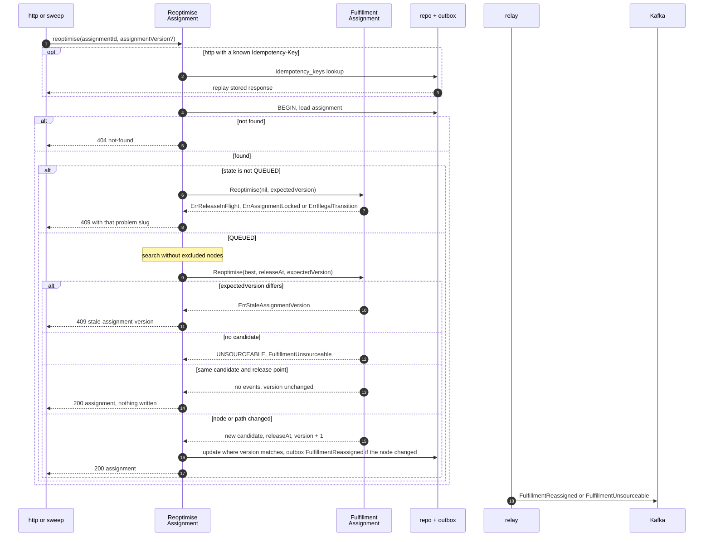
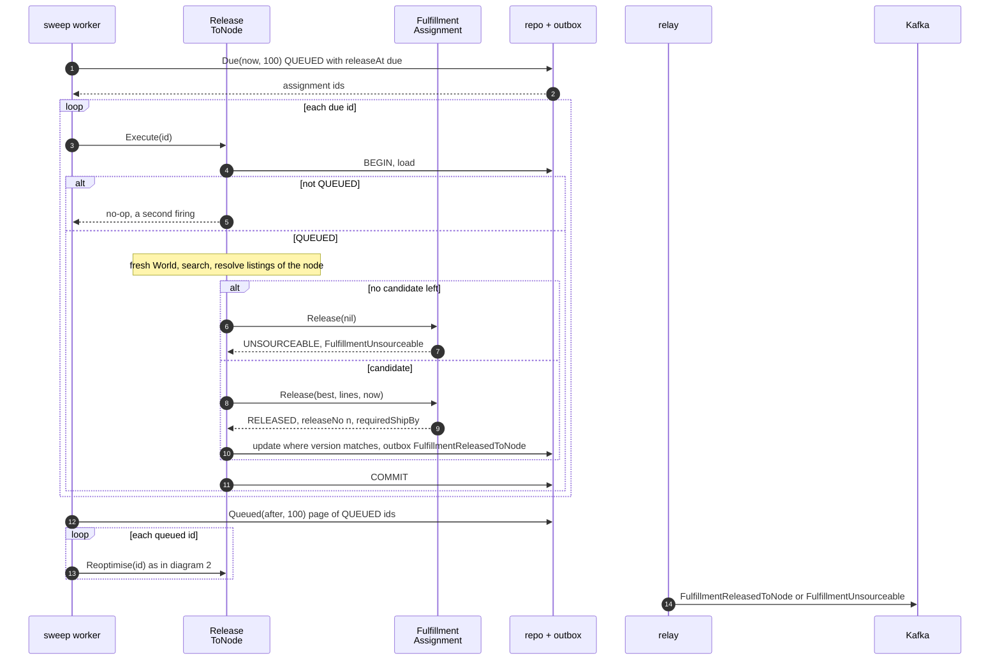
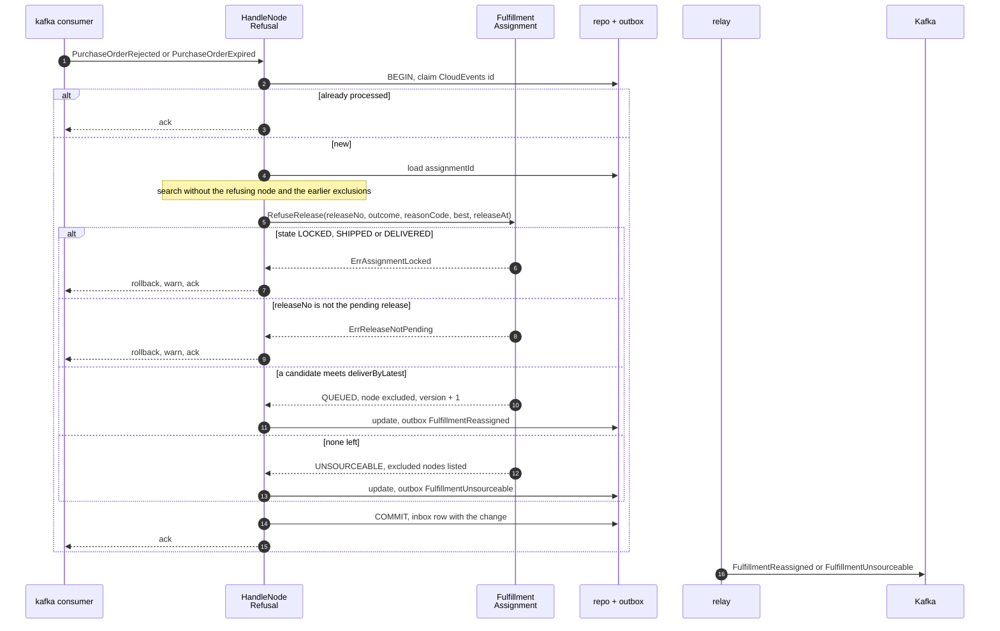
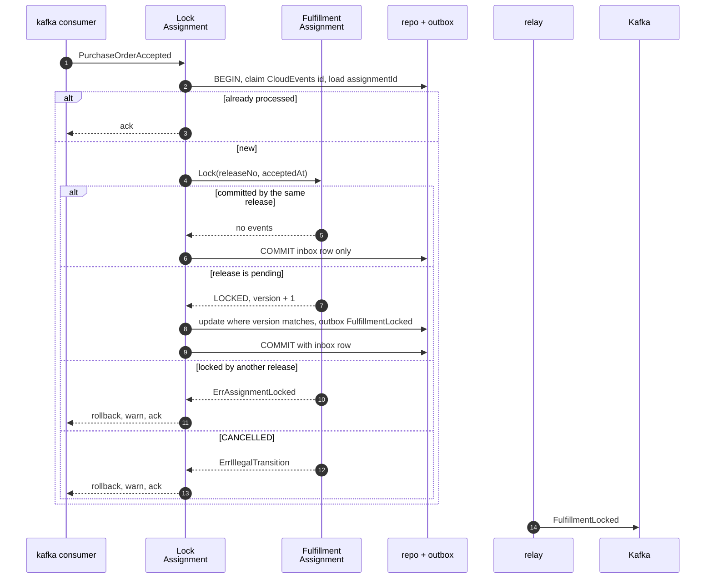
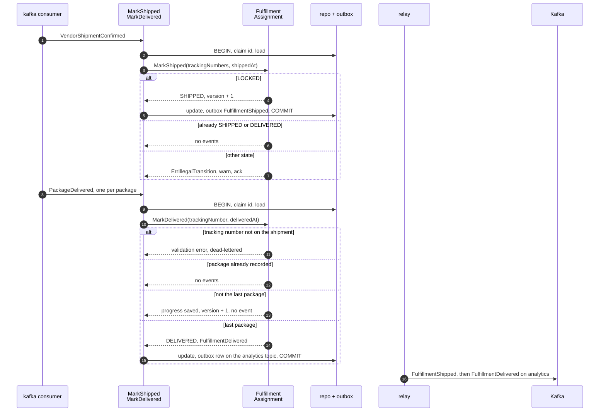
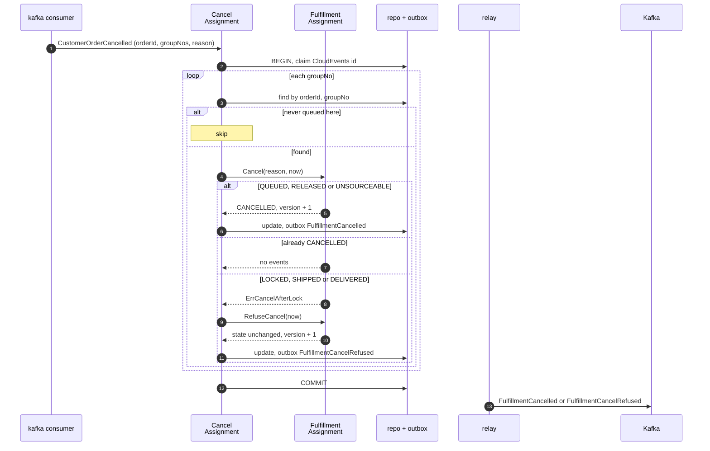
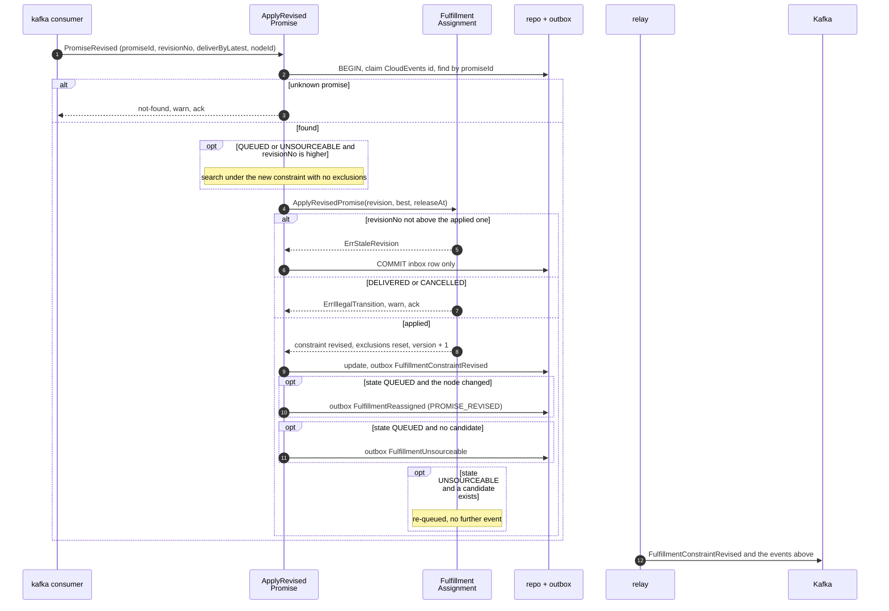

# Sequence diagrams

One diagram per command use case on [Use cases](/docs/ddd/use-cases). The participants:

| Participant | Component |
| --- | --- |
| adapter | `internal/adapters/inbound/kafka` consumer, `internal/adapters/inbound/http` handler, or the sweep worker in `cmd/api` |
| use case | `internal/application/usecases.<Command>` |
| aggregate | `assignment.Assignment` (`FulfillmentAssignment`) |
| repo + outbox | `internal/adapters/outbound/postgres`: the assignment repository, `outbox_events`, `processed_events` and `idempotency_keys`, all joined to **one** transaction by `UnitOfWork` |
| relay | `internal/adapters/outbound/outbox` with the Kafka sink |
| Kafka | `retailnetwork.order-sourcing.events` (or `.analytics`) |

Every command runs through `writer.mutate` or the equivalent in `usecases/writer.go`: claim the inbox row (Kafka triggers), load,
call one domain method, save, append the events to the outbox, commit. The save is an optimistic compare-and-swap on `version`;
a lost race is `ErrConcurrentUpdate`, and `transact` re-runs the whole attempt once on fresh state before the error escapes. A
command that changes nothing (the version did not move) writes nothing. Event names are short; the full type is
`com.retailnetwork.commerce.order-sourcing.assignment.<EventName>`. The relay half (outbox to Kafka) is the same in every diagram,
so it is drawn in full in diagram 1.

Source: `internal/application/usecases/*.go`, `internal/domain/assignment/commands.go`,
`internal/adapters/inbound/kafka/consumer.go`.

## 1. QueueAssignment

Source: `usecases/queue.go` (`QueueAssignment.execute`, `queueGroup`, `releaseNow`), `domain/assignment/assignment.go` (`Queue`).
The unique key on `(order_id, group_no)` also rejects a racing duplicate insert (`ErrDuplicateGroup`, counted as a failed
outcome). All groups of one event commit in one transaction; a crash before `COMMIT` leaves nothing and the event is redelivered.

## 2. ReoptimiseAssignment

Source: `usecases/commands.go` (`ReoptimiseAssignment.Execute`), `domain/assignment/commands.go` (`Reoptimise`, `guardMovable`),
`inbound/http/server.go` (`handleReoptimise`), `inbound/http/idempotency.go`. The Idempotency-Key row is stored in the same
transaction as the request. The sweep calls the same use case with expected version 0 and skips a row that returns a lock,
in-flight or concurrent-update error.

## 3. The sweep and ReleaseToNode

Source: `usecases/sweep.go` (`SweepQueue.Execute`), `usecases/commands.go` (`ReleaseToNode.Execute`), `cmd/api/main.go`
(`startSweep`, `sweepOnce`). One pass runs every `SWEEP_INTERVAL`. A row another writer changed, or that already moved on, is
counted as skipped. `vendor-connectivity` issues the purchase order idempotently on `assignmentId` + `releaseNo`, so a republished
event issues no second purchase order.

## 4. HandleNodeRefusal

Source: `usecases/commands.go` (`HandleNodeRefusal.Execute`), `domain/assignment/commands.go` (`RefuseRelease`),
`inbound/kafka/consumer.go` (`neverApplicable`). A re-queued assignment whose new `releaseAt` is already past is released by the
next sweep tick (diagram 3).

## 5. LockAssignment

Source: `usecases/commands.go` (`LockAssignment.Execute`), `domain/assignment/commands.go` (`Lock`). The `CANCELLED` branch is the
known residual "acceptance after cancellation": the acceptance is only logged and the vendor may still ship the group
([Bounded context canvas](/docs/ddd/bounded-context-canvas#open-questions)).

## 6. MarkShipped and MarkDelivered

Source: `usecases/commands.go` (`MarkShipped`, `MarkDelivered`), `domain/assignment/commands.go`. `FulfillmentDelivered` goes only
to `retailnetwork.order-sourcing.analytics`.

## 7. CancelAssignment

Source: `usecases/cancel_revise.go` (`CancelAssignment.Execute`, `cancelOne`), `domain/assignment/commands.go` (`Cancel`,
`RefuseCancel`). All groups of one event are decided in one transaction. A pending release stays as it is: `vendor-connectivity`
cancels the purchase order on `FulfillmentCancelled`.

## 8. ApplyRevisedPromise

Source: `usecases/cancel_revise.go` (`ApplyRevisedPromise.Execute`, `apply`), `domain/assignment/commands.go`
(`ApplyRevisedPromise`, `reapply`). In `RELEASED`, `LOCKED` and `SHIPPED` only the constraint changes: the node already
committed. A re-queued assignment is released by diagram 3.
