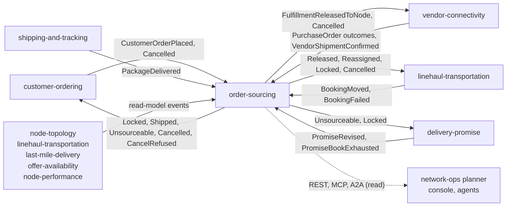

# Integration

How `order-sourcing` fits with the rest of the fleet, with the **status of every edge**. Three words are used strictly:

- **Built**: code on this repository's `develop` that does the job.
- **Verified**: the other side was read on its own local `origin/develop` and names the same type. The clones were read at
  `vendor-connectivity` `1cea903`, `linehaul-transportation` `1c190ff`, `delivery-promise` `3e73d84` and `customer-ordering`
  `22353fb` (a local `git grep` of the handler files; the clones were not fetched by this run).
- **Not read**: the producer side of the nine upstream topics was not re-read for this page; the types come from this service's
  handlers and `apis/asyncapi.yaml`.

This context **calls no sibling**: it has no outbound HTTP client, no MCP client and no A2A client
(`TestA2AHasNoOutboundClient`), and every decision is made from local read models fed by events ([ADR 0003](/docs/adr/0003-consumed-contracts-and-local-read-models)).
The single broker is the platform's one Kafka; `cmd/api` refuses to boot without `KAFKA_BROKERS` and the nine consumer group ids.

## Edge map

Source: `internal/adapters/inbound/kafka/handlers.go` (consumed side), `internal/adapters/outbound/kafka/encoder.go` and
`internal/domain/assignment/events.go` (published side), `apis/asyncapi.yaml`, and the four downstream handler files named
below. Solid edges carry Kafka events; the dotted edge is the read surface.

## Upstream: what Order Sourcing consumes

Nine topics, 32 types, nine consumer groups (the full list with fields is the [event catalogue](/docs/api-reference/events)).

| Producer | Protocol and topic | Contract (types) | What it drives | Status |
| --- | --- | --- | --- | --- |
| customer-ordering | Kafka, `retailnetwork.customer-ordering.events` | `CustomerOrderPlaced`, `CustomerOrderCancelled` | `QueueAssignment`, `CancelAssignment` | **Built.** Dispatch on the full type; per-group queueing and idempotency on `(orderId, groupNo)`. |
| delivery-promise | Kafka, `retailnetwork.delivery-promise.events` | `PromiseRevised`, `PromiseBookExhausted` | `ApplyRevisedPromise`; book pressure read model | **Built.** A revision not above the applied `revisionNo` is ignored. |
| vendor-connectivity | Kafka, `retailnetwork.vendor-connectivity.events` | `PurchaseOrderAccepted`, `PurchaseOrderRejected`, `PurchaseOrderExpired`, `VendorShipmentConfirmed` | `LockAssignment`, `HandleNodeRefusal`, `MarkShipped` | **Built.** Each outcome carries `assignmentId` and, for the purchase-order ones, `releaseNo`. |
| shipping-and-tracking | Kafka, `retailnetwork.shipping-and-tracking.events` | `PackageDelivered` | `MarkDelivered` | **Built.** One event per package; the group delivers on the last. |
| linehaul-transportation | Kafka, `retailnetwork.linehaul-transportation.events` | `DepartureScheduled`, `DepartureCapacityChanged`, `DepartureCancelled`, `BookingMoved`, `BookingFailed` | departures read model; `RecordPickupMoved`; `RecordProcessed` | **Built.** `BookingFailed` is only recorded as processed. |
| last-mile-delivery | Kafka, `retailnetwork.last-mile-delivery.events` | `DeliveryWaveScheduled`, `DeliveryWaveCapacityChanged`, `DeliveryWaveCancelled` | waves read model | **Built.** |
| node-topology | Kafka, `retailnetwork.node-topology.events` | `NodeRegistered`, `NodeOperationalProfileDeclared`, `NodeActivated`, `NodeSuspended`, `NodeRetired`, `LaneOpened`, `LaneClosed`, `ServiceAreaAssigned`, `RegionDefined` | nodes, lanes, service areas, regions | **Built.** Upserts; newer `profileRevision` / `assignmentVersion` wins. |
| offer-availability | Kafka, `retailnetwork.offer-availability.events` | `ListingCreated`, `ListingAvailabilityChanged`, `ListingSuppressed`, `ListingRestored`, `CatalogItemDiscontinued` | listings and discontinued items | **Built.** An older `asOf` is ignored. |
| node-performance | Kafka, `retailnetwork.node-performance.events` | `NodeScorecardUpdated` | scorecards | **Built.** An older `computedAt` is ignored. |

All of them are CloudEvents 1.0 in structured mode, decoded only by `internal/adapters/kafka/cloudevents`.

### How every consumed message is handled

(`internal/adapters/inbound/kafka/consumer.go`, `deadletter.go`)

- Dispatch on the **full** `type`; every other type on those topics is ignored and its offset committed.
- A message that is not a valid CloudEvents 1.0 event is logged at WARN and committed past; it is not dead-lettered.
- The claim of the CloudEvents `id` (table `processed_events`) and the effect commit in **one** Postgres transaction; the Kafka
  offset is committed afterwards (at least once). A redelivered id changes nothing.
- A payload that can never be applied (undecodable `data`, a validation error) goes to `<topic>.dlq` at once. An event the
  aggregate can no longer take (not found, illegal transition, locked, release not pending, stale revision or version) is
  logged and acknowledged.
- A transient failure is retried with capped backoff (200 ms to 5 s), 5 attempts, then published to `<topic>.dlq` with `x-dlq-*`
  headers. Shutdown never dead-letters.
- Group ids come from `<PRODUCER>_CONSUMER_GROUP` with no default; a missing one is a boot error naming it.

## Downstream: what Order Sourcing publishes

Ten events through the transactional outbox, at least once, key = `assignmentId`: eight to `retailnetwork.order-sourcing.events`,
`FulfillmentQueued` and `FulfillmentDelivered` to `retailnetwork.order-sourcing.analytics` only.

| Consumer | Protocol and topic | Contract | Status |
| --- | --- | --- | --- |
| vendor-connectivity | Kafka, `retailnetwork.order-sourcing.events` | `FulfillmentReleasedToNode` (becomes a purchase order, idempotent on `assignmentId` + `releaseNo`), `FulfillmentCancelled` | **Built + verified.** `internal/adapters/inbound/kafka/consumers.go` on its `origin/develop` handles exactly these two types. |
| linehaul-transportation | same | `FulfillmentReleasedToNode`, `FulfillmentReassigned`, `FulfillmentLocked`, `FulfillmentCancelled` | **Built + verified.** `internal/adapters/inbound/kafka/handlers.go` handles these four. |
| delivery-promise | same | `FulfillmentLocked`, `FulfillmentShipped`, `FulfillmentUnsourceable` | **Built + verified.** `internal/adapters/inbound/kafka/dispatch.go` handles these three; `FulfillmentUnsourceable` is what asks for a re-promise, and its `PromiseRevised` answer comes back as upstream traffic. |
| customer-ordering | same | `FulfillmentLocked`, `FulfillmentShipped`, `FulfillmentUnsourceable`, `FulfillmentCancelled`, `FulfillmentCancelRefused` | **Built + verified.** `internal/adapters/inbound/kafka/handlers.go` handles these five. |
| any consumer | same | `FulfillmentConstraintRevised` | **Published, no consumer found** in the four clones above. |
| analytics read side | Kafka, `retailnetwork.order-sourcing.analytics` | `FulfillmentQueued`, `FulfillmentDelivered` | **Published, no consumer in this repository**; no domain consumer is known. |
| network-ops planner, console, agents | REST `GET /assignments`, `GET /assignments/{id}`, `POST /assignments/{id}/reoptimisations`; MCP; A2A | `apis/openapi.yaml`, [MCP tools](/docs/mcp/tools), [API overview](/docs/api-reference#a2a) | **Built.** The web remote `order_sourcing_mfe` (`web/`, [ADR 0007](/docs/adr/0007-console-remote)) calls only this context's own `/api/order-sourcing`. |

Compared with the design pack in `warehouse-docs` (`domain-events`), the downstream handlers on `origin/develop` read more than the
pack lists: `delivery-promise` also reads `FulfillmentShipped`, and `customer-ordering` also reads `FulfillmentCancelled` and
`FulfillmentCancelRefused`. The code of each consumer is the reference.

## Infrastructure wiring

The Kong routes `/api/order-sourcing` (prefix stripped), `/api/mcp/order-sourcing` (rewritten to `/mcp`) and
`/api/a2a/order-sourcing` (rewritten to `/`) come from `warehouse-infra` `helm-values/order-sourcing.yaml`, summarised in the
[Runbook](/docs/operations/runbook#components). The service needs Postgres (all three binaries) and the platform Kafka broker
(`cmd/api` only); it creates no topic through an admin API.

## Absent edges (on purpose)

- **No REST, MCP or A2A call to any sibling, in either direction.** `sync_calls` is empty; a neighbour outage delays freshness of
  the read models, never a release.
- **No edge to `network-fulfillment`.** The hard boundary: no retail-network context calls a warehouse-systems fleet service or
  reads a fleet topic. The fleet reaches this context's decisions only as purchase orders it polls from
  `vendor-connectivity`'s Vendor API.
- **No payment, notification or returns edge**: no code on either side.
- **No PII crosses any edge.** Only the destination postal prefix is stored, never an address or a person; a release carries no
  ship-to data.
- **No auth on any inbound surface** (fleet decision).

## Failure behaviour

| Situation | Behaviour |
| --- | --- |
| Postgres down at boot | Migrations and the first ping are retried by `bootretry` (5 attempts, about 15 s of backoff), then the process exits 1 and the orchestrator restarts it. |
| Postgres down at runtime | REST writes fail (500 `internal-error`); consumers fail transiently, retry and after 5 attempts dead-letter; `/readyz` answers 503 `dependency-unavailable`. `cmd/mcp` and `cmd/a2a` answer tool or skill errors as `internal-error`. |
| Kafka down | REST reads and the writes that only touch Postgres keep working: the aggregate and its `outbox_events` row commit in one transaction. `/readyz` turns 503 (`not ready: kafka`), so the pod leaves the Service. The relay retries every interval and rows wait; consumers block and resume. |
| Downstream consumer down | Events wait in the topic; its own consumer group resumes. Nothing in this service blocks on it. |
| Duplicate or replayed event | The inbox makes it a no-op; the outbox keeps the same CloudEvents `id`. |
| Late outcome of an old release | `releaseNo` is not the pending one: logged and acknowledged. |
| Cancel after the lock | Refused with `FulfillmentCancelRefused`; the state does not change. |
| Stale read model (a node, departure or listing event is late) | Decisions use the data as it stands; the sweep re-optimises `QUEUED` assignments every `SWEEP_INTERVAL` and the release re-checks the candidate against fresh models. |
| Poison message | Dead-lettered; the partition moves on. Nothing in this repository reads or replays a `.dlq` topic. |
| Outbox row parked at `OUTBOX_MAX_ATTEMPTS` | Skipped and logged once at ERROR; later events of the same assignment can overtake it. Re-arm it as in the [Runbook](/docs/operations/runbook#outbox-relay). |
