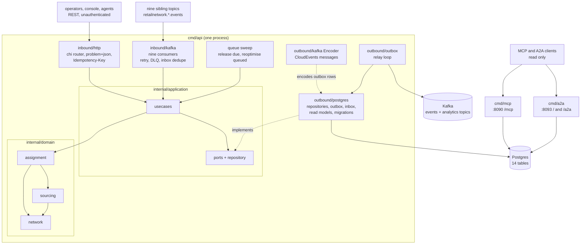

# Architecture

`order-sourcing` follows the fleet's hexagonal (ports and adapters) layout: dependencies point inward, the domain imports nothing
from the rest of the module, and only `cmd/` wires the layers together. Everything on this page is on `develop`.

## Layout

| Layer | Path | Role |
| --- | --- | --- |
| Domain | `internal/domain/assignment` | The `Assignment` aggregate (`FulfillmentAssignment`): states, transitions, commands, the domain events it records, snapshots, typed errors. |
| Domain | `internal/domain/sourcing` | The pure search: `Search` over a `World`, candidate cost, `ReleaseAt`, the tier rules. No I/O. |
| Domain | `internal/domain/network` | Value types of the local read models: `Node`, `Lane`, `Departure`, `Wave`, `ServiceArea`, `Region`, `Listing`, `Scorecard`, `Pressure`. |
| Domain | `internal/domain/shared` | The `Event` interface every domain event satisfies. |
| Application | `internal/application/usecases` | The use cases (see [Use cases](/docs/ddd/use-cases)): `QueueAssignment`, `SweepQueue`, `ReoptimiseAssignment`, `ReleaseToNode`, `HandleNodeRefusal`, `LockAssignment`, `MarkShipped`, `MarkDelivered`, `RecordPickupMoved`, `CancelAssignment`, `ApplyRevisedPromise`, `Projector`, `RecordProcessed`, and the read-only `Queries`. |
| Application | `internal/application/ports`, `repository`, `views`, `outbox` | The OUT ports (`AssignmentRepository`, `ReadModels`, `WorldReader`, `EventOutbox`, `Inbox`, `UnitOfWork`, `Clock`, `IDGenerator`, `IdempotencyStore`, `SourcingMetrics`), the filter and world-query structs, the read views returned by queries, and the outbox record. `ports` holds only interfaces. |
| Inbound adapter | `internal/adapters/inbound/http` | chi router for `apis/openapi.yaml`: handlers, RFC 9457 problem mapping (`errors.go`), the `Idempotency-Key` middleware, `/healthz` and `/readyz`. No auth middleware. |
| Inbound adapter | `internal/adapters/inbound/kafka` | One consumer per consumed topic (nine): CloudEvents decode, dispatch on the full `type`, retry with backoff, dead-letter topic. Decode only; every effect is a use case. |
| Inbound adapter | `internal/adapters/inbound/mcp` | Read-only MCP tools `list_assignments` and `get_assignment`. |
| Inbound adapter | `internal/adapters/inbound/a2a` | Read-only A2A agent: skills `find_assignments` and `assignment_detail`, the Agent Card. |
| Inbound adapter | `internal/adapters/inbound/requestlog` | Request logging shared by the HTTP-facing binaries. |
| Outbound adapter | `internal/adapters/outbound/postgres` | pgxpool repositories, the unit of work (`pgtx`), the world reader and read-model writers, the outbox and the inbox, embedded migrations (`migrations/0001_order_sourcing_schema.up.sql`). |
| Outbound adapter | `internal/adapters/outbound/memory` | In-memory implementation of the repository ports: a **test double** for the unit and BDD suites. No shipped binary imports it (`TestRuntimeBinaryHasNoInMemoryAdapters`). |
| Outbound adapter | `internal/adapters/outbound/repocontract` | The repository contract suite run against both the memory and the Postgres adapters. |
| Outbound adapter | `internal/adapters/outbound/kafka` | `Encoder` (domain event to CloudEvents message and topic), `Writer` (acks all, hash balancer, auto-create), `RelaySink`, `BrokerCheck` (the Kafka half of `/readyz`). |
| Outbound adapter | `internal/adapters/outbound/outbox` | The relay loop that drains `outbox_events` to the sink, with the attempt cap. |
| Outbound adapter | `internal/adapters/outbound/telemetry` | OpenTelemetry setup, the `slog` bridge, the `sourcing.groups.sourced` counter (`SourcingMetrics`). |
| Outbound adapter | `internal/adapters/outbound/clock`, `ids` | The system clock and the UUID assignment ids, the two adapters that need no infrastructure. |
| Kafka envelope | `internal/adapters/kafka/cloudevents` | The only place a CloudEvents 1.0 envelope is built or decoded. |
| Support | `internal/bootretry` | Exponential-backoff retry for the first outbound dials at boot. |
| Composition roots | `cmd/api`, `cmd/mcp`, `cmd/a2a` | Environment parsing, wiring, workers, shutdown order. |
| Test support | `internal/testing/pgtest` | Shared testcontainers helper for Postgres integration tests. |
| Fitness tests | `internal/architecture` | Source-scanning and import-graph tests; see below. |
| Operator UI | `web/` | The `order_sourcing_mfe` Module Federation remote ([ADR 0007](/docs/adr/0007-console-remote)); not a Go binary. |

The domain's central dependency is one-way: `assignment` imports `sourcing` and `network`, `sourcing` imports `network`, and none
imports `application` or an adapter. The search is a pure function of an immutable `World` snapshot that the application layer
loads through `WorldReader` for one search; the aggregate only stores the chosen candidate and the exclusion list.

## Binaries and ports

| Binary | Role | Port | Probes |
| --- | --- | --- | --- |
| `cmd/api` | REST API, nine Kafka consumers, the virtual-queue sweep and the outbox relay in one process, always on real Postgres and Kafka. | `HTTP_ADDR`, default `:8080` | `GET /healthz` (liveness), `GET /readyz` (drain gate, Postgres ping, a Kafka broker answers a metadata request; never topics) |
| `cmd/mcp` | Read-only MCP server (Streamable HTTP) over the query use cases; Postgres only, no relay, consumer or Kafka ([ADR 0006](/docs/adr/0006-mcp-server-adoption)). | `MCP_ADDR`, default `:8090` | `GET /healthz` |
| `cmd/a2a` | Read-only A2A (Agent2Agent) server over the same queries: JSON-RPC at `/` and `/a2a`, Agent Card at `/.well-known/agent-card.json`; Postgres only ([ADR 0009](/docs/adr/0009-a2a-inbound-adapter)). | `A2A_ADDR`, default `:8093` | `GET /healthz` |

How each binary boots, drains and stops is on [Runtime](/docs/overview/runtime); every variable is in
[Configuration](/docs/operations/configuration).

## Container diagram

Source: `cmd/api/main.go` (`buildServices`, `startConsumers`, `startOutboxRelay`, `startSweep`), `cmd/mcp/main.go`,
`cmd/a2a/main.go`, `internal/application/ports/ports.go`, the import lists of `internal/domain/*/*.go` and
`internal/architecture/architecture_test.go`. The in-memory adapters are not in the diagram because no binary wires them.

## Data stores

One Postgres database, created by the single embedded migration
(`internal/adapters/outbound/postgres/migrations/0001_order_sourcing_schema.up.sql`, applied by golang-migrate at every boot):

| Table | Holds |
| --- | --- |
| `assignments` | The `FulfillmentAssignment` aggregate: one row per `(order_id, group_no)` (unique), the chosen candidate and `release_at`, the release history, excluded nodes, lock, shipment and delivery facts; `version` guards every update. A partial index serves the queue (`state = 'QUEUED'` by `release_at`). |
| `rm_nodes`, `rm_lanes`, `rm_departures`, `rm_waves`, `rm_service_areas`, `rm_regions` | The network view: node profiles, the lane graph, pickup departures with remaining capacity, delivery waves, postal-prefix service areas and regions. |
| `rm_listings`, `rm_discontinued_items` | The availability view: per node and item quantity and the discontinued item set. |
| `rm_scorecards` | The node scorecard grade per `(node_id, score_window)`. |
| `rm_book_pressure` | The promise-book pressure per `book_id`, used as the 500 point cost term. |
| `processed_events` | CloudEvents ids already applied: the inbox that makes the consumers idempotent. |
| `outbox_events` | The transactional outbox; one row per message, with `attempts`, `last_error` and `published_at`. |
| `idempotency_keys` | Stored answers of `POST /assignments/{assignmentId}:reoptimise`, replayed for 24 hours. |

Postgres is the only store: `cmd/api` refuses to boot without `DATABASE_URL`, and nothing is served from process memory.
Kafka is the platform's single broker. This service consumes nine `retailnetwork.<producer>.events` topics (see
[Integration](/docs/ecosystem/integration)) and produces to `retailnetwork.order-sourcing.events` and
`retailnetwork.order-sourcing.analytics`. It never creates a topic through an admin API: the broker auto-creates each on first
write (the relay's writer allows it), and `/readyz` does not wait for any topic.

## Rules enforced by `internal/architecture`

The tests run on every PR (`arch-test` job, `make arch-test`); the list and the sensor tests that prove each detector bites are on
[Testing](/docs/development/testing#architecture-fitness-tests). The ones that shape the layout:

| Test | Rule |
| --- | --- |
| `TestHexagonalArchitecture` | Domain depends only on domain; application only on domain and application; inbound and outbound adapters do not depend on each other; nothing under `internal/` imports `cmd`; `ports` holds only interfaces. |
| `TestMCPAdapterDependencyRule`, `TestMCPOptionalToolInputsCarryOmitempty` | The MCP adapter depends only on application and domain and nothing depends on it; optional tool inputs carry `omitempty`. |
| `TestA2AAdapterDependencyRule`, `TestA2AAgentIsReadOnly`, `TestA2AHasNoOutboundClient`, `TestA2ABinaryIsKafkaFreeAndReadOnly` | The A2A adapter and `cmd/a2a` reach only read use cases, no Kafka, and no file imports an A2A client. |
| `TestNoAuthMiddlewareReintroduced` | No bearer-token or JWT code under `internal/adapters/inbound`: the surface is unauthenticated fleet-wide. |
| `TestRuntimeBinaryHasNoInMemoryAdapters` | No non-test file under `cmd/**` imports `internal/adapters/outbound/memory` or `repocontract`. |
| `TestKafkaConsumerGroupNeverHardcodedInline`, `TestKafkaWritersSetRequiredAcks`, `TestKafkaWriterTopicNotSetTwice`, `TestReplayConsumersSetCommitInterval`, `TestDeadLetterCallsGuardCancellation` | Consumer groups come from the environment, every writer sets `RequiredAcks`, the topic is set on the message or the writer but not both, and a shutdown never dead-letters a message that was only mid-flight. |
| `TestOutboxRelaysPassAttemptCap` | Every relay is built with `WithMaxAttempts(...)`. |
| `TestCloudEventsOnly`, `TestNoEventEnvelopeToggleOrFlatEnvelope`, `TestEventCatalogueMatchesContract` | CloudEvents 1.0 is the only envelope and the AsyncAPI catalogue matches the ADR. |
| `TestNoGoFilesAtRepoRoot` | No Go file sits at the repository root. |
